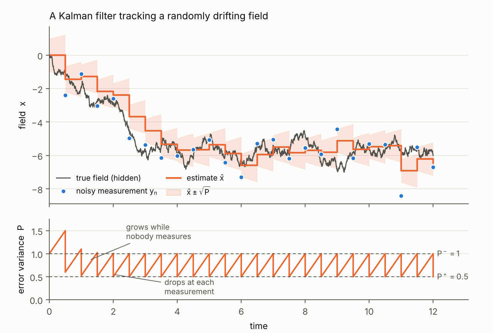
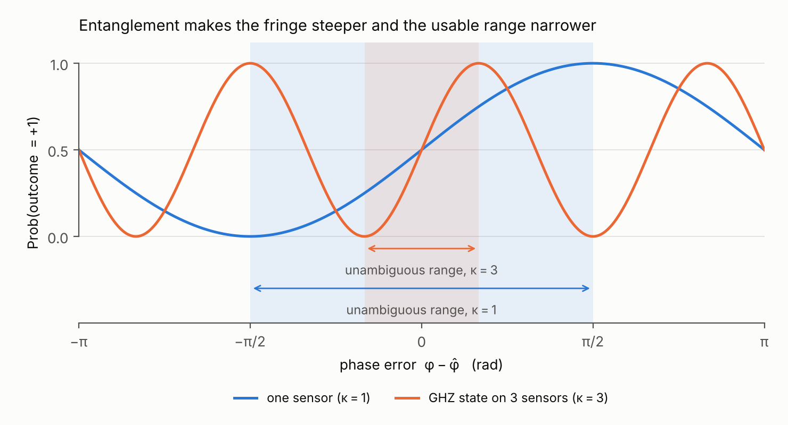
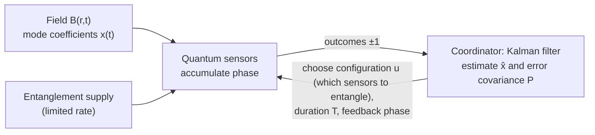
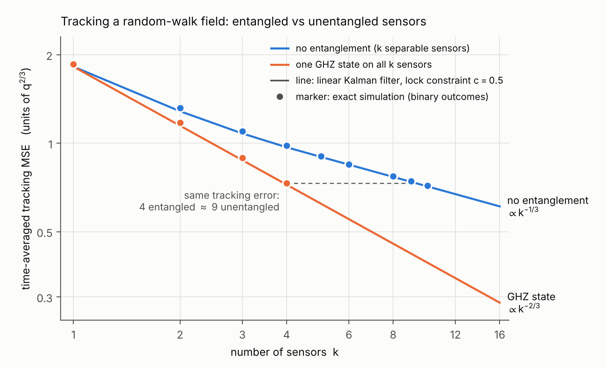
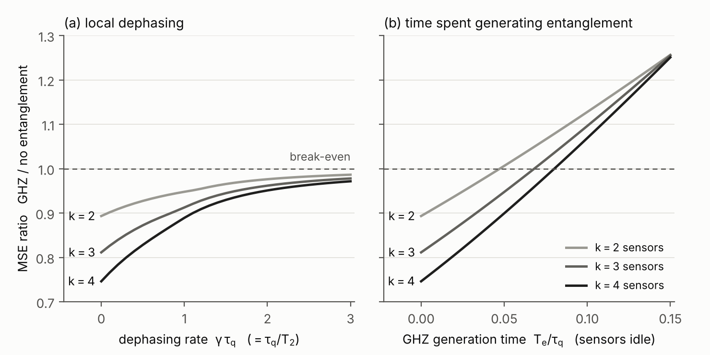
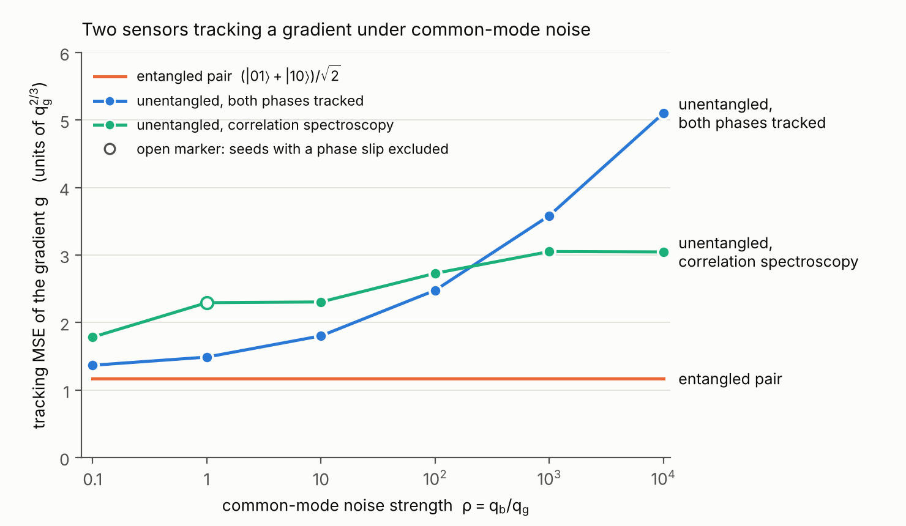
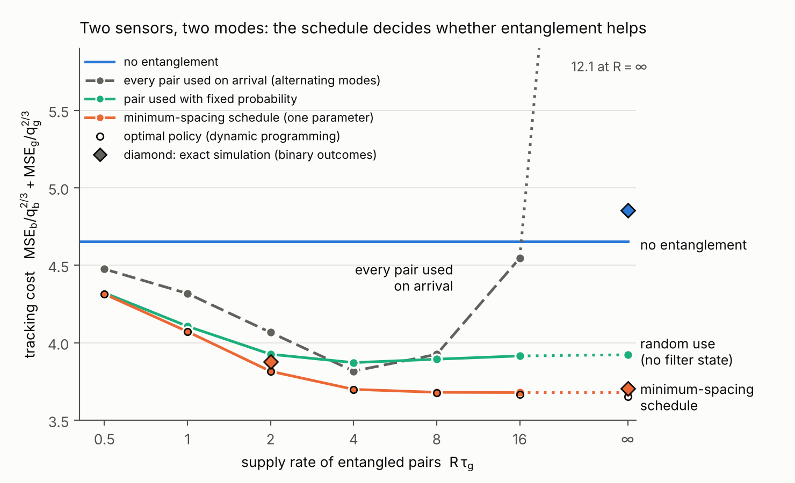

# Direction A: Tracking a Time-Varying Field with an Entangled Network of Quantum Sensors

**Problem formulation, introductory version.** It explains the Kalman filter from scratch and assumes only that the reader knows what a qubit and a measurement are. The Chinese version is [problem_formulation_zh.md](problem_formulation_zh.md).

## 0　The direction in one paragraph

Several quantum sensors, for example atomic magnetometers, are placed at different locations and jointly track a field that changes over time and across space. What is tracked is not the value at each location but a few spatial modes of the field, for example its uniform component and its gradient. Every measurement is noisy, so an algorithm is needed that turns a stream of noisy measurements into the best estimate of the field and also reports how reliable that estimate is. That algorithm is the Kalman filter. The sensors can share entanglement, which turns several sensors into one more precise sensor. Entanglement is expensive, however, and an entangled measurement is sensitive to only one combination of the field.

The question studied in this direction is: **using the uncertainty reported by the Kalman filter, decide when and among which sensors to use entanglement, and how long each measurement lasts, so that the tracking error is minimized.**

How to read: Section 1 says what is measured and maps it to problems studied in the literature. Section 2 explains the Kalman filter. Section 3 explains what kind of measurement a quantum sensor provides and what entanglement changes. Section 4 is the formal problem formulation. Sections 5 and 6 are the two toy models. Section 7 summarizes what is new. A glossary and self-check questions are at the end.

## 1　The problem

### 1.1　One sensor: tracking a number that changes in time

A magnetic field in general depends on both time and position, $B(\mathbf r,t)$. A sensor at $\mathbf r_j$ measures only the value at its own location, $B(\mathbf r_j,t)$. Sections 2 and 3 explain the method with a single sensor, which sees a number that changes only in time, $x(t)=B(\mathbf r_1,t)$. The field is position-independent there only because there is one position. Section 1.2 says what is measured with several sensors.

The value $x(t)$ drifts randomly over time. We cannot see $x$ directly; we can only measure it from time to time, and every measurement is noisy. Two questions must be answered:

1. Given all measurements so far, what is the most likely current value of $x$?
2. How reliable is that answer?

Using only the latest measurement leaves too much noise. Averaging all measurements uses data that are long out of date, because the field keeps changing. The right approach lies in between: old information is used, but discounted over time. For linear models with Gaussian noise, the Kalman filter gives the optimal way to discount.

### 1.2　Several sensors: the targets are spatial modes of the field

Over the region occupied by the sensors, expand the field in spatial modes:

$$B(\mathbf r,t)=\sum_{k=1}^{d}x_k(t)\,f_k(\mathbf r).$$

The $f_k$ are fixed spatial functions, usually the first terms of a Taylor expansion. For sensors along a line, $f_1=1$ is the uniform component, $f_2=2z/L$ the gradient ($L$ is the array length), and $f_3$ the quadratic term (curvature). The quantities to estimate and track are the coefficients $x_k(t)$. A sensor at $\mathbf r_j$ sees

$$B(\mathbf r_j,t)=\sum_{k}f_k(\mathbf r_j)\,x_k(t),$$

a linear combination of the modes whose coefficients are set by the sensor's position. In the language of Section 2.7, **the position of a sensor sets one row of the output matrix.** For example, with two sensors at $z=\pm L/2$ and the first two modes kept, write $b=x_1$ and $g=x_2$; the two sensors see $b+g$ and $b-g$. Both toy models below use this example.

The targets are mode coefficients rather than the values at individual locations, for two reasons.

1. **Finitely many sensors determine finitely many degrees of freedom.** $N$ sensors give $N$ linear combinations, and modes that are not kept alias into those that are; two sensors, for instance, cannot separate the uniform component from the curvature. When the sources are far from the array compared with its size, higher modes decay as powers of that ratio and the truncation error is small.
2. **Entanglement helps only for combinations of values at several locations.** For estimating the value at each location separately, unentangled sensors are already optimal ([Proctor–Knott–Dunningham, PRL 2018](https://arxiv.org/abs/1707.06252)). For a linear function of the local values, entanglement reaches the Heisenberg limit ([Eldredge et al., PRA 2018](https://arxiv.org/abs/1607.04646)), and the size of the advantage depends on the coefficients of the function ([Rubio et al., J. Phys. A 2020](https://arxiv.org/abs/2003.04867)). Mode coefficients are such functions.

**Targets and disturbances.** Which modes are targets and which are disturbances depends on the application. The table lists three cases studied in the literature; each toy model corresponds to one of them.

| Target | Other modes | Application | Prior work | Here |
|---|---|---|---|---|
| Uniform component $x_1$ | None: the field is uniform over the array, $d=1$ | Axion dark-matter searches, where the field's coherence length far exceeds the array and every sensor sees the same signal; atomic-clock networks, where the nodes jointly track a drifting local-oscillator frequency with GHZ states | [Brady et al., PRX Quantum 2022](https://arxiv.org/abs/2203.05375); [Kómár et al., Nat. Phys. 2014](https://arxiv.org/abs/1310.6045) | Section 5.1 |
| Gradient $x_2$, or a higher mode | Lower modes are disturbances (common-mode noise) and change fast | Gradiometry: nearby sources such as the heart or brain produce a clear gradient across the array, while distant sources (power lines, traffic, geomagnetic fluctuations) produce a nearly uniform field that is much larger than the signal | Theory [Sekatski–Wölk–Dür, PRR 2020](https://arxiv.org/abs/1905.06765); experiment [Bate et al., PRL 2025](https://arxiv.org/abs/2501.08940) (three ions, target the quadratic term, constant and gradient as noise); unentangled OPM gradiometer for cardiac and brain signals [QST 2024](https://arxiv.org/abs/2402.10113) | Section 5.2 |
| Uniform component and gradient | Both are targets | Measuring the field and its gradient together | [Li et al., Science 2026](https://arxiv.org/abs/2504.08677) (a BEC split into parts, mean and gradient); [Zhang et al., Nat. Commun. 2026](https://arxiv.org/abs/2412.18398) (superconducting modules, vector field and gradient) | Section 6 |

Apart from Kómár 2014, these works estimate the mode coefficients as constant parameters. Here every coefficient $x_k(t)$ drifts randomly, so the problem changes from parameter estimation to tracking. Tracking adds two things absent from parameter estimation: the measurement duration must be traded against how fast the field changes (Section 3.2), and with several modes, when to entangle and which combination to entangle becomes a scheduling problem (Section 6).

## 2　The Kalman filter, starting in one dimension

### 2.1　Two models

**Process model (how the state changes).** Over each time step $\Delta$ the field drifts randomly:

$$x_{n+1}=x_n+w_n,\qquad w_n\sim\mathcal N(0,\;q\Delta).$$

The variance of the drift grows in proportion to elapsed time, and the constant $q$ describes how fast the field changes. This model is a random walk; its continuous-time version is the Wiener process.

**Measurement model (what a measurement sees).**

$$y_n=x_n+v_n,\qquad v_n\sim\mathcal N(0,\;r).$$

$r$ is the measurement-noise variance; the smaller $r$, the more precise the measurement.

### 2.2　The two numbers the filter keeps

- $\hat x$: the current estimate.
- $P$: the variance of the estimation error, $P=E[(x-\hat x)^2]$.

$P$ is the filter's own estimate of how uncertain it is. In several dimensions it is a matrix, the **error covariance**.

### 2.3　Two operations per step

**Predict (time update).** Before the next measurement the field has drifted, in an unknown direction. The best guess stays the same and the uncertainty grows:

$$\hat x^-=\hat x,\qquad P^-=P+q\Delta .$$

**Update (measurement update).** A new measurement $y$ arrives, and the filter takes a weighted average of prediction and measurement:

$$\hat x^+=\hat x^-+K\,(y-\hat x^-),\qquad K=\frac{P^-}{P^-+r},\qquad P^+=(1-K)\,P^- .$$

- $K$ is the **Kalman gain**. When the prediction is unreliable ($P^-$ large) or the measurement is precise ($r$ small), $K\to1$ and the measurement dominates; otherwise the prediction dominates.
- $y-\hat x^-$ is the **innovation**, the part of the measurement that the prediction did not anticipate. The filter corrects its estimate only by this part.

### 2.4　A worked example

Take $q\Delta=0.5$, $r=1$, and start from $\hat x=0$, $P=1$.

| Step | $P^-=P+0.5$ | $K=P^-/(P^-+1)$ | $P^+=(1-K)P^-$ |
|---|---|---|---|
| 1 | 1.5 | 0.60 | 0.60 |
| 2 | 1.1 | 0.524 | 0.524 |
| 3 | 1.024 | 0.506 | 0.506 |
| steady state | 1.0 | 0.5 | 0.5 |

If the first measurement is $y=1.2$, the new estimate is $\hat x^+=0+0.6\times1.2=0.72$.

Figure 0. Top: the hidden true field (gray), the measurements (blue), the estimate (orange) and a $\pm\sqrt P$ band. Bottom: $P$ grows linearly between measurements (predict), drops at each measurement (update), and quickly settles into a fixed sawtooth.

**Note that the table never uses the value of $y$.** This matters in Section 6.

### 2.5　Steady-state error

Combining predict and update gives a recursion for $P$, the **Riccati equation**:

$$P^-_{n+1}=P^+_n+q\Delta,\qquad P^+_n=\frac{r\,P^-_n}{P^-_n+r}.$$

It converges to a steady state:

$$P^+=\tfrac12\Big(\sqrt{(q\Delta)^2+4rq\Delta}-q\Delta\Big).$$

With the example's numbers, $P^+=\tfrac12(\sqrt{0.25+2}-0.5)=0.5$, as in the table.

Between two measurements the error grows linearly from $P^+$ to $P^-$, so the time-averaged error is

$$J=P^++\tfrac12q\Delta=\tfrac12\sqrt{(q\Delta)^2+4rq\Delta}.$$

In the example $J=0.75$. The formula says that more precise measurements (small $r$) reduce the error, and so do more frequent measurements (small $\Delta$). For a quantum sensor these two goals conflict, as Section 3 shows.

### 2.6　Two properties

1. **The evolution of $P$ does not depend on the measured values.** Once the measurement used at each step is fixed, the whole trajectory of $P$ can be computed in advance.
2. **Optimality.** For a linear model with Gaussian noise, the Kalman filter is the minimum mean-square-error estimator.

### 2.7　Several dimensions

The state is a vector, for example $x=(b,g)$ with $b$ the mean field and $g$ its gradient:

$$x_{n+1}=Ax_n+w_n,\quad w_n\sim\mathcal N(0,Q);\qquad y_n=Cx_n+v_n,\quad v_n\sim\mathcal N(0,R).$$

The equations keep the same form:

$$P^-=APA^\top+Q,\quad K=P^-C^\top(CP^-C^\top+R)^{-1},\quad \hat x^+=\hat x^-+K(y-C\hat x^-),\quad P^+=(I-KC)P^- .$$

$C$ is the **output matrix**: each row says which linear combination of the state a measurement sees. The diagonal entries of $P$ are the error variances of the components, so $P$ shows which component is currently least known. If a different $C$ can be chosen at each step, choosing it is the **sensor scheduling** problem. This direction studies such a problem, with the choices of $C$ provided by entanglement.

Example: the two sensors of Section 1.2, whose local fields are $b+g$ and $b-g$. Measured separately, $C=\begin{pmatrix}1&1\\1&-1\end{pmatrix}$ and both components are seen. Section 3.3 shows that an entangled measurement can give $C=(0,\;2)$: it sees only $g$, with twice the gain.

## 3　What measurement a quantum sensor provides

### 3.1　The Ramsey measurement

A qubit, for example an atomic spin, is prepared in a superposition and then evolves in the field for a time $T$, the **interrogation time**, accumulating a phase

$$\varphi=\int_t^{t+T}x(s)\,ds .$$

Here $x$ is in units of angular frequency (field times gyromagnetic ratio). Before readout we add a phase $\hat\varphi$ of our choice, and the readout gives one bit $m=\pm1$:

$$P(m=+1)=\tfrac12\big[1+\sin(\varphi-\hat\varphi)\big].$$

A single measurement yields a single bit, so it is very noisy.

### 3.2　Turning it into something the Kalman filter can use

When $\varphi-\hat\varphi$ is small, $\sin$ is nearly linear and the outcome is approximately

$$m\approx(\varphi-\hat\varphi)+v,\qquad \mathrm{Var}(v)\approx1 .$$

Since $\varphi\approx Tx$, this is a measurement of $x$ with noise variance $r=1/T^2$. **A longer $T$ gives a more precise measurement**, at two costs:

1. **Slower measurements.** One measurement occupies time $T$, so $\Delta=T$, and the field drifts meanwhile.
2. **Reading the wrong fringe.** $\sin$ is periodic. Once $\varphi-\hat\varphi$ exceeds about $\pi/2$, the same outcome corresponds to several phases and the filter can lock onto the wrong one (a **phase slip**).

The second point means that $\hat\varphi$ must be set from the filter's prediction, $\hat\varphi=T\hat x^-$, and that $T$ must stay short enough for the prediction error to remain in the linear range:

$$\kappa\,\sigma_\varphi\le c\approx0.5,\qquad \sigma_\varphi^2=\mathrm{Var}(\varphi-\hat\varphi)\ \text{determined by }P\text{ and }T.$$

$\kappa$ is the phase amplification, $\kappa=1$ for a single qubit. We call this the **lock constraint**. It means that **the duration of each measurement must be set by the filter's current error covariance.**

Substituting $r=1/(\mathcal I T^2)$ and $\Delta=T$ into Section 2.5, where $\mathcal I$ is the information per cycle ($\mathcal I=1$ for a single qubit):

$$J(T)=\tfrac12\sqrt{q^2T^2+\frac{4q}{\mathcal I\,T}} .$$

Too short a $T$ measures poorly; too long a $T$ cannot keep up. The optimum is

$$T^*=\Big(\frac{2}{\mathcal I q}\Big)^{1/3},\qquad J^*\approx1.09\;q^{2/3}\,\mathcal I^{-1/3}.$$

**The characteristic time of the signal is $\tau_q=q^{-1/3}$.** In a time $\tau$ the field drifts by $\sqrt{q\tau}$, while one measurement of length $\tau$ resolves the field to about $1/\tau$; the two are equal at $\tau=q^{-1/3}$. Below, time is measured in units of $\tau_q$ and the MSE in units of $q^{2/3}=1/\tau_q^2$.

### 3.3　What entanglement changes

Let $k$ sensors measure the same field.

- **Without entanglement**, each sensor returns one bit with noise variance $1/T^2$; together $\mathcal I=k$.
- **With a GHZ state** $(|0\cdots0\rangle+|1\cdots1\rangle)/\sqrt2$, the phase accumulates $k$ times faster, $\kappa=k$. The readout gives one bit with $P(m=+1)=\tfrac12[1+\sin k(\varphi-\hat\varphi)]$; after linearization the noise variance is $1/(k^2T^2)$, i.e. $\mathcal I=k^2$.

In output-matrix terms, the same $k$ sensors go from "$k$ rows, each with gain 1" to "one row with gain $k$": less noise, fewer combinations seen.

There are three costs:

1. **A narrower fringe.** The linear range shrinks by a factor $k$, the lock constraint becomes $k\sigma_\varphi\le c$, and the measurement depends more on the filter's prediction (figure below).
2. **Faster decoherence.** If each qubit dephases at rate $\gamma=1/T_2$, the GHZ visibility decays as $e^{-k\gamma T}$.
3. **Entanglement must be generated.** Between distant nodes it is slow, probabilistic and short-lived.

**The entangled combination can be chosen.** Sensors at different locations see different fields. For two sensors with fields $b+g$ and $b-g$, the state $(|00\rangle+|11\rangle)/\sqrt2$ accumulates their sum $2b$, while $(|01\rangle+|10\rangle)/\sqrt2$ accumulates their difference $2g$. Choosing the entangled state therefore chooses which row of the output matrix is measured precisely.

## 4　Formal problem formulation

We take the fully centralized version: all outcomes go to one coordinator, which runs the filter and decides the next measurement.

**State and dynamics.** The state is the vector of mode coefficients of Section 1.2, $x=(x_1,\dots,x_d)\in\mathbb R^d$, each an independent random walk: $dx=Q^{1/2}dW$ with $Q=\mathrm{diag}(q_1,\dots,q_d)$. There are $N$ sensors; sensor $j$ sits at $\mathbf r_j$ and sees $B(\mathbf r_j,t)=c_j^\top x$ with $c_j=\big(f_1(\mathbf r_j),\dots,f_d(\mathbf r_j)\big)^\top$.

**Decisions.** At the start of cycle $n$ the coordinator chooses:

- a configuration $u_n\in\mathcal U$: a partition of the sensors into groups, each measured separately or entangled in a particular state. Each configuration gives an output matrix $C(u)$ and a noise covariance $R(u,T)$;
- the interrogation time $T_n$;
- the feedback phase $\hat\varphi_n$, given by the prediction.

**Constraints.**

1. Lock constraint: every group satisfies $\kappa\,\sigma_\varphi(P_n,T_n)\le c$.
2. Resources: entangled configurations consume entanglement, which arrives randomly at a finite rate and can be stored only in limited amounts.
3. Dephasing: the visibility decays exponentially in $\kappa\gamma T$.

**Information structure.** A policy $\pi$ chooses $(u_n,T_n)$ from the current error covariance and resource state.

**Objective.** Minimize the time-averaged weighted tracking error

$$J=\lim_{\tau\to\infty}\frac1\tau\int_0^\tau E\big[(x-\hat x)^\top W(x-\hat x)\big]\,dt .$$

The weight matrix $W$ selects the targets: target modes get positive weight and disturbance modes get zero weight. The three cases in the table of Section 1.2 are $d=1$; $W=\mathrm{diag}(0,1)$; and both diagonal entries of $W$ positive.

**Two questions.**

1. **Is there an advantage?** Under the best policy for each, how much lower is the error of an entangled network than that of an unentangled one, and under what conditions? See Section 5.
2. **How should entanglement be scheduled?** What does the optimal policy look like, can simple rules come close, and when is online covariance feedback valuable? See Section 6.

## 5　Toy model 1: does entanglement help?

There is only one mode to measure, so there is no scheduling question; we compare entangled and unentangled networks. Details (in Chinese): [toy_model_A/toy_model_analysis_zh.md](toy_model_A/toy_model_analysis_zh.md).

The numbers come from two sources. "Linear Kalman filter" uses the linearization of Section 3.2. "Exact simulation" keeps the true $\pm1$ outcomes and estimates with a particle filter, a numerical Bayes filter that handles the nonlinear measurement, with lock parameter $c=0.5$. Ratios agree between the two; constants differ slightly.

### 5.1　$k$ sensors tracking one field

Here the field is assumed uniform over the sensors, so there is one mode and all $k$ sensors see the same value. This is a modeling assumption, valid when the field's spatial correlation length is much larger than the array. It is the first row of the table in Section 1.2: axion dark-matter searches and atomic-clock networks. The same model also describes $k$ atoms in one atomic clock tracking a common local oscillator.

From Section 3.2, $J\propto\mathcal I^{-1/3}$. With $\mathcal I=k$ unentangled and $\mathcal I=k^2$ for a GHZ state,

$$J_{\text{unentangled}}\propto k^{-1/3},\qquad J_{\text{GHZ}}\propto k^{-2/3}.$$

| $k$ | MSE, unentangled | MSE, GHZ | GHZ lower by | Unentangled sensors for the same MSE |
|---|---|---|---|---|
| 1 | 1.86 | 1.86 | 0 | 1 |
| 2 | 1.32 | 1.17 | 11% | 2.6 |
| 3 | 1.10 | 0.89 | 19% | 5.2 |
| 4 | 0.98 | 0.73 | 26% | 9.4 |

Exact simulation, MSE in units of $q^{2/3}$.

**Why the exponent is only 1/3.** When a constant parameter is estimated, doubling the information halves the variance. When a changing field is tracked, part of the extra information is spent on shortening $T$ to keep up with the change, so the error falls only as $\mathcal I^{-1/3}$. For a few sensors the difference in error is therefore modest. In resources the difference is quadratic: matching $k$ entangled sensors takes about $0.6k^2$ unentangled ones.

**Conditions.**

- Coherence time no shorter than the signal's characteristic time, $T_2\gtrsim\tau_q$. At $T_2=\tau_q$ the gain for $k=4$ falls from 26% to 11%.
- Entanglement available in time: generating one GHZ state must take less than 20–50% of the interrogation time, or, if generated in parallel, 4–7 states must be supplied per $\tau_q$.
- GHZ contrast at least 0.8–0.9.

### 5.2　Two sensors tracking a gradient under common-mode noise

The two sensors sit at $z=\pm L/2$ and see $b+g$ and $b-g$ (Section 1.2). The target is the gradient $g$; the uniform component $b$ is a disturbance that changes $\rho$ times faster ($q_b=\rho\,q_g$). This is gradiometry, the second row of the table in Section 1.2: a nearby source produces the gradient signal, while the ambient field from distant sources is the same at both sensors, much larger than the signal and faster-changing, so $\rho\gg1$. The constant-parameter version is the theory of Sekatski–Wölk–Dür 2020 and the experiment of Bate 2025.

- **The entangled pair** $(|01\rangle+|10\rangle)/\sqrt2$ accumulates only $2g$ and does not see $b$ at all; its error does not depend on $\rho$.
- **Without entanglement**, either both $b$ and $g$ are tracked, and $T$ is limited by the fast $b$, or only the product of the two outcomes is used (correlation spectroscopy), which carries a quarter of the information of the entangled pair.

| $\rho=q_b/q_g$ | 0.1 | 1 | 10 | 100 | 1000 | $10^4$ |
|---|---|---|---|---|---|---|
| Entangled pair | 1.17 | 1.17 | 1.17 | 1.17 | 1.17 | 1.17 |
| Better unentangled strategy | 1.37 | 1.49 | 1.80 | 2.48 | 3.05 | 3.05 |

MSE in units of $q_g^{2/3}$. With strong common-mode noise the unentangled error is 2.6 times that of the entangled pair, and five unentangled pairs are needed to match one entangled pair.

**Conclusion of toy model 1.** Entanglement helps, in precision and in resources. These conclusions agree with known results for atomic clocks, so they are not the new contribution of this direction.

## 6　Toy model 2: scheduling

Both modes must be tracked and entanglement is supplied at a limited rate. This is the smallest model in which scheduling appears. Details (in Chinese, called toy 3 there): [toy_model_A/toy3_scheduling_zh.md](toy_model_A/toy3_scheduling_zh.md).

### 6.1　Setup

Two sensors with fields $b+g$ and $b-g$; $b$ changes fast ($q_b=1000\,q_g$), as in the gradiometry setting of Section 5.2. The difference is that both modes are tracked, the third row of the table in Section 1.2, as in experiments that measure the field and its gradient together (Li 2026; Zhang 2026). The cost is the sum of their normalized errors:

$$J=\frac{\mathrm{MSE}_b}{q_b^{2/3}}+\frac{\mathrm{MSE}_g}{q_g^{2/3}} .$$

Each cycle uses one of three measurements:

| Label | Measurement | Uses entanglement | Sees $b$ | Sees $g$ | $T$ limited by |
|---|---|---|---|---|---|
| S | each sensor measured separately | no | yes (information 2) | yes (information 2) | $b$ and $g$; in practice $b$ |
| B | entangled, measures $b$ | yes | yes (information 4) | no | $b$ only |
| G | entangled, measures $g$ | yes | no | yes (information 4) | $g$ only |

All three give the same total information per unit $T^2$. Entanglement does not add information; it concentrates it on one mode.

Entangled pairs arrive at random with mean rate $R$, and at most one is stored.

### 6.2　Results

Exact simulation, ample supply:

| Policy | Cost |
|---|---|
| no entanglement | 4.85 |
| use each pair on arrival ($b$ and $g$ alternately) | 12.4 |
| spacing rule: after a G cycle, wait a fixed time before the next | 3.70 |
| optimal policy (dynamic programming) | 3.74 |

The optimal policy was computed in the linear Kalman filter model, where it beats the spacing rule by 0.7%; in the exact simulation the two differ by 1%, within statistical fluctuation.

1. **Without scheduling, entanglement hurts.** During a G cycle nobody measures $b$, and $b$ changes fast, so its error grows quickly. Using each pair on arrival costs 2.6 times as much as not using entanglement at all.
2. **With scheduling, the cost drops by 24%.** With S alone, $T$ is kept short by $b$ and $g$ receives little information per cycle. Inserting a G cycle every few S cycles helps because the G cycle's $T$ is limited only by $g$ and can be 4–5 times longer, so a single G cycle gives $g$ about 40 times the information of an S cycle.
3. **Little entanglement is needed:** about 2.5 pairs per $\tau_g$; at $R=2/\tau_g$ most of the gain is already obtained.
4. **A simple rule is near-optimal.** The one-parameter spacing rule is within 1% of the optimum.
5. **The gain depends on how different the modes are.** For $q_b/q_g\le10$ the optimal policy does not use entanglement at all; the gain is 7% at 100 and 21% at 1000 (linear Kalman filter). The lower the weight on $b$, the larger the gain; with zero weight the problem becomes Section 5.2 and the factor is 2.6.

### 6.3　Is online feedback useful?

As noted in Section 2.6, in the linear model $P$ does not depend on the measured values, so the times at which to use G can be computed in advance and amount to a fixed spacing. In the exact simulation the measurement is nonlinear and $P$ fluctuates with the data, yet a policy that uses the real-time $P$ performs within 1% of the offline spacing rule.

So **the measurement duration must be set online from the error covariance (lock constraint), while when and among which sensors to entangle can be designed offline.** This agrees with classical sensor scheduling.

## 7　What is new in this direction

| Ingredient | Status |
|---|---|
| Several sensors share entanglement to estimate one or a few field modes as constant parameters | Known; theory and experiments with 2–4 nodes (table in Section 1.2) |
| Kalman filtering of a time-varying signal with a single quantum sensor | Known |
| Choosing measurements from the error covariance (sensor scheduling) | Classical problem with mature theory |
| All three together: a Kalman filter driving an entangled sensor network to track a time-varying field | No prior work found |

The toy models show that the combination is necessary: with several modes, unscheduled entanglement hurts and scheduled entanglement helps. As a sensor scheduling problem it has three features absent from the classical setting:

1. The available output matrices come from entanglement configurations, with a trade-off between rank and gain at fixed total information.
2. The admissible measurements depend on the current error covariance (lock constraint).
3. Measurements consume a resource that arrives at random and decays.

**Open questions.** As the number of nodes grows, the number of entanglement configurations grows exponentially and offline scheduling becomes intractable: how do the computational cost and the gain of scheduling scale with the number of nodes? When the signal statistics are nonstationary, does online feedback start to pay off? When stored entanglement decays, how should one decide between using it now and waiting?

## Glossary

| Term | Meaning |
|---|---|
| state | the quantity to estimate; here, the coefficients of the field modes |
| spatial mode | one term $f_k(\mathbf r)$ of the expansion of the field in position, e.g. uniform component, gradient, curvature |
| common-mode noise | a disturbance that is the same at all sensors; here, the uniform component |
| process noise | the random change of the state, with intensity $q$ or $Q$ |
| measurement noise | the random error of a measurement, with variance $r$ or $R$ |
| error covariance | $P$, the filter's estimate of its own error |
| predict, time update | $P$ grows between measurements |
| measurement update | $P$ drops at a measurement |
| Kalman gain | $K$, the weight between measurement and prediction |
| innovation | $y-\hat x^-$, the part of a measurement the prediction did not anticipate |
| output matrix | $C$, which combinations of the state a measurement sees |
| sensor scheduling | choosing which measurement to use at each step |
| interrogation time | $T$, the time over which a Ramsey measurement accumulates phase |
| lock constraint | $\kappa\sigma_\varphi\le c$, which keeps the measurement in its linear range |
| phase slip | the error leaves the linear range and the filter locks onto the wrong fringe |
| GHZ state | $(\lvert0\cdots0\rangle+\lvert1\cdots1\rangle)/\sqrt2$, which accumulates $k$ times the phase |
| coherence time, $T_2$ | how long a qubit keeps its superposition |
| particle filter | a numerical Bayes filter that represents the distribution by samples |

## Self-check questions

1. In the example of Section 2.4, if r changes from 1 to 0.25 (more precise measurements), does the steady-state K increase or decrease?

It increases. $P^+=\tfrac12(\sqrt{0.25+0.5}-0.5)\approx0.18$, $P^-\approx0.68$, and $K=0.68/(0.68+0.25)\approx0.73$, larger than 0.5. The measurement is more trustworthy, so the filter relies on it more.

2. Why are the targets the coefficients of the field modes rather than the values at the sensor locations?

Two reasons. $N$ sensors determine only $N$ linear combinations, so only finitely many modes can be estimated. More importantly, for estimating the value at each location separately, unentangled sensors are already optimal and entanglement does not help; entanglement helps only for combinations of values at several locations, and mode coefficients are such combinations.

3. Why can P be computed in advance, and what does that imply for scheduling?

In a linear Gaussian model the predict and update equations for $P$ involve only $q$, $\Delta$, $r$ and $C$, never $y$. Once the measurement used at each step is fixed, the trajectory of $P$ is determined, so the schedule can be optimized offline. The conclusion of Section 6.3 follows from this.

4. A GHZ state raises the information per cycle from k to k². Why does the error improve only from k^(-1/3) to k^(-2/3), and not from 1/k to 1/k²?

When tracking a time-varying signal, the error has two parts: the measurement noise and the drift of the field during the measurement. Part of the extra information is spent on shortening $T$ to reduce the drift, so $J\propto\mathcal I^{-1/3}$. Only for a constant parameter, with no drift, does the error scale as $1/\mathcal I$.

5. Why can a GHZ measurement not do without the Kalman filter's prediction?

The GHZ fringe is $k$ times narrower, so an outcome has a definite meaning only when $|\varphi-\hat\varphi|$ is small. $\hat\varphi$ must come from the filter's prediction, and $T$ must be kept short enough according to the filter's $P$; otherwise phase slips occur.

6. In toy model 2 all three measurements carry the same total information. Where does the benefit of entanglement come from?

From choosing $T$ separately for each mode. Measuring separately, $T$ is limited by the fast mode $b$. An entangled measurement sees only $g$, so its $T$ is limited only by $g$ and can be much longer. Information grows as $T^2$, so one long G cycle gives $g$ far more information than one short S cycle.

7. In toy model 2, why is using each pair on arrival worse than not using entanglement at all?

An entangled measurement sees only one mode. Used back to back, it leaves the other mode unmeasured for a long cycle, and the error of the fast mode grows quickly. The more entanglement is available, the worse the unscheduled use becomes.

## Further material

- [toy_model_A/](toy_model_A/): detailed toy-model analyses (in Chinese), figures and code.
- [literature/](literature/): surveys of prior work (in Chinese).
