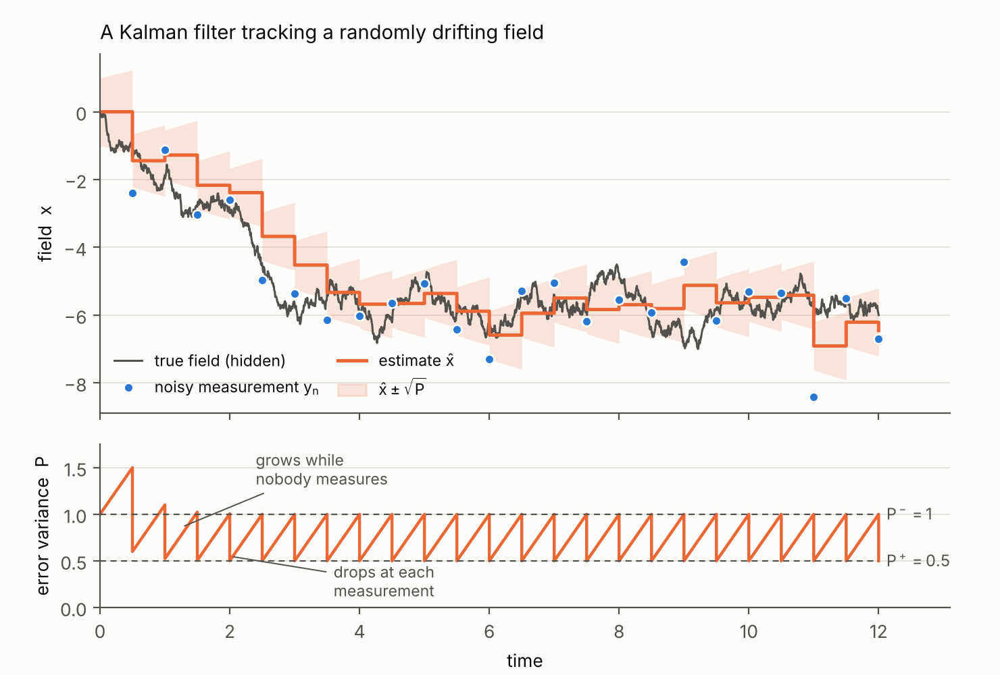
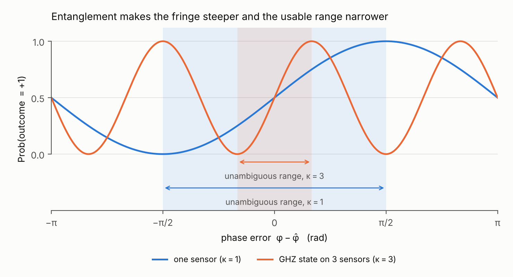
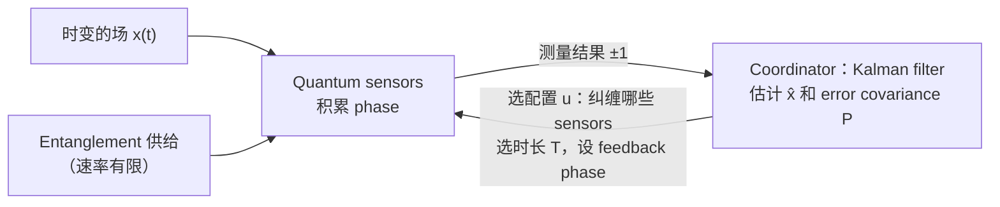
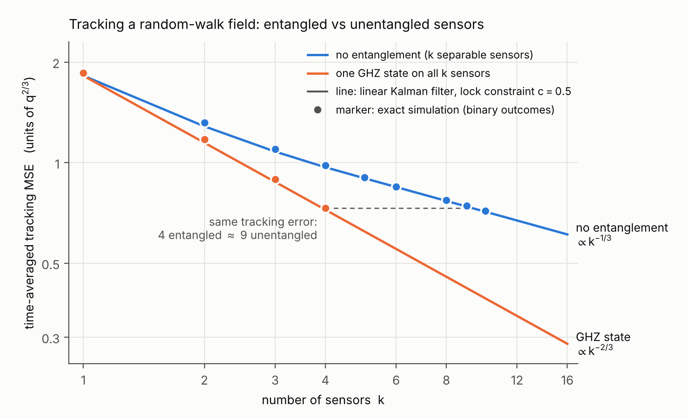
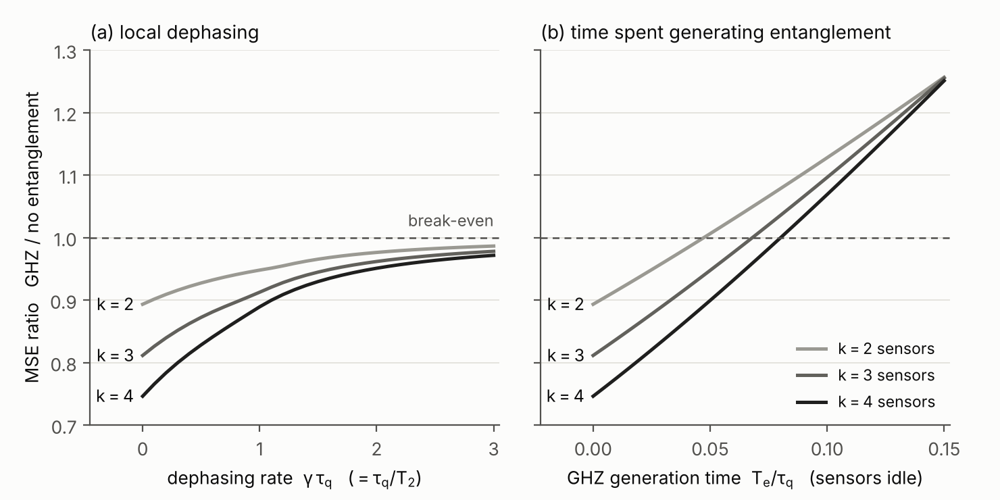
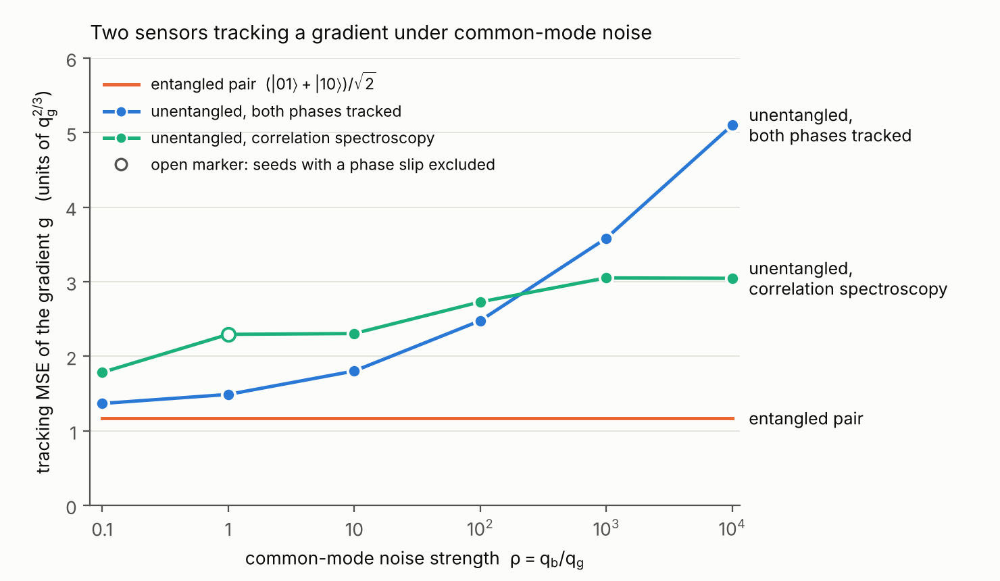
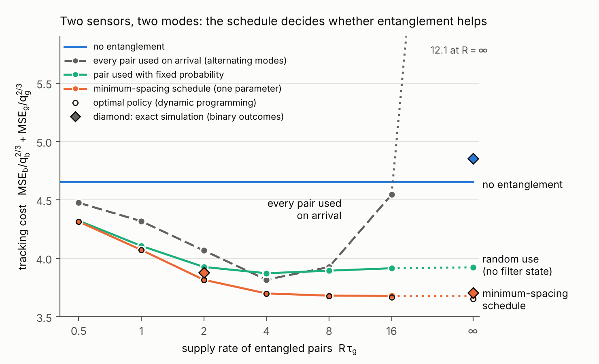

# 方向 A：用纠缠的 quantum sensor 网络跟踪时变的场

**入门版 problem formulation。** 从零讲 Kalman filter，量子部分只假设读者知道 qubit 和测量。英文版见 [problem_formulation_en.md](problem_formulation_en.md)。

## 0　一段话说明这个方向

在不同位置放多个 quantum sensors（例如测磁场的 atomic magnetometers），一起跟踪一个随时间变化的场。每次测量都有噪声，所以需要一个算法，把一连串带噪声的测量变成对场的最好估计，并且给出这个估计的可信程度。这个算法就是 Kalman filter。Sensors 之间可以共享 entanglement，把几个 sensors 变成一个更精确的 sensor。但 entanglement 很贵，而且纠缠后的测量只对场的某一个组合敏感。

这个方向研究的问题是：**根据 Kalman filter 给出的不确定度，决定何时、在哪些 sensors 之间使用 entanglement，以及每次测多久，使跟踪误差最小。**

读法：第 1、2 节讲 Kalman filter；第 3 节讲 quantum sensor 给出什么样的测量，以及 entanglement 改变了什么；第 4 节是正式的 problem formulation；第 5、6 节是两个 toy model；第 7 节总结创新点。文末有术语表和自测题。

## 1　要解决的问题

设一个磁场 $x(t)$ 随时间随机漂移。我们看不到 $x$ 本身，只能每隔一段时间测一次，每次测量都有噪声。要回答两个问题：

1. 根据到现在为止的所有测量，$x$ 现在最可能是多少？
2. 这个答案有多可信？

只用最新一次测量，噪声太大。把所有测量平均，又会用到早已过时的数据，因为场一直在变。正确的做法介于两者之间：旧信息要用，但要随时间打折扣。在线性、高斯噪声的条件下，Kalman filter 给出最优的打折扣方式。

## 2　Kalman filter：从一维讲起

### 2.1　两个模型

**Process model（状态怎样变化）。** 每过时间 $\Delta$，场随机漂移一次：

$$x_{n+1}=x_n+w_n,\qquad w_n\sim\mathcal N(0,\;q\Delta).$$

漂移的方差与经过的时间成正比，比例系数 $q$ 描述场变化有多快。这种模型叫 random walk，连续时间的版本叫 Wiener process。

**Measurement model（测量看到什么）。**

$$y_n=x_n+v_n,\qquad v_n\sim\mathcal N(0,\;r).$$

$r$ 是测量噪声的方差，$r$ 越小测量越准。

### 2.2　Filter 保存的两个数

- $\hat x$：当前的估计值。
- $P$：估计误差的方差，$P=E[(x-\hat x)^2]$。

$P$ 是 filter 对自己有多不确定的估计。多维时它是一个矩阵，叫 **error covariance**。

### 2.3　每一步做两件事

**Predict（time update）。** 下一次测量之前，场漂移了，但不知道往哪个方向。最好的猜测不变，不确定度变大：

$$\hat x^-=\hat x,\qquad P^-=P+q\Delta .$$

**Update（measurement update）。** 新测量 $y$ 到来，把预测和测量做加权平均：

$$\hat x^+=\hat x^-+K\,(y-\hat x^-),\qquad K=\frac{P^-}{P^-+r},\qquad P^+=(1-K)\,P^- .$$

- $K$ 叫 **Kalman gain**。预测不可信（$P^-$ 大）或测量很准（$r$ 小）时 $K\to1$，以测量为主；反过来以预测为主。
- $y-\hat x^-$ 叫 **innovation**，是测量里预测不到的部分。Filter 只根据这部分修正估计。

### 2.4　算一个例子

取 $q\Delta=0.5$，$r=1$，起点 $\hat x=0$，$P=1$。

| 步 | $P^-=P+0.5$ | $K=P^-/(P^-+1)$ | $P^+=(1-K)P^-$ |
|---|---|---|---|
| 1 | 1.5 | 0.60 | 0.60 |
| 2 | 1.1 | 0.524 | 0.524 |
| 3 | 1.024 | 0.506 | 0.506 |
| 稳态 | 1.0 | 0.5 | 0.5 |

第 1 步如果测到 $y=1.2$，新估计是 $\hat x^+=0+0.6\times1.2=0.72$。

图 0：上图中灰线是看不到的真实场，蓝点是测量，橙线是估计，阴影是 $\pm\sqrt P$。下图是 $P$：两次测量之间线性增长（predict），每次测量时下降（update），很快进入一个固定的锯齿。

**请注意表里的计算从头到尾没有用到 $y$ 的值。** 这一点在第 6 节很重要。

### 2.5　稳态误差

把 predict 和 update 合起来，$P$ 满足一个递推，叫 **Riccati equation**：

$$P^-_{n+1}=P^+_n+q\Delta,\qquad P^+_n=\frac{r\,P^-_n}{P^-_n+r}.$$

它收敛到一个稳态：

$$P^+=\tfrac12\Big(\sqrt{(q\Delta)^2+4rq\Delta}-q\Delta\Big).$$

代入例子的数，$P^+=\tfrac12(\sqrt{0.25+2}-0.5)=0.5$，与表一致。

两次测量之间误差从 $P^+$ 线性涨到 $P^-$，所以按时间平均的误差是

$$J=P^++\tfrac12q\Delta=\tfrac12\sqrt{(q\Delta)^2+4rq\Delta}.$$

例子里 $J=0.75$。公式说明：测得越准（$r$ 小）误差越小，测得越勤（$\Delta$ 小）误差也越小。对 quantum sensor 来说，这两件事互相冲突，见第 3 节。

### 2.6　两个性质

1. **$P$ 的演化不依赖测量值。** 只要知道每一步用什么测量，$P$ 的整条轨迹可以事先算出来。
2. **最优性。** 模型是线性的、噪声是高斯的时候，Kalman filter 是均方误差最小的估计器。

### 2.7　多维的情形

状态是向量，例如 $x=(b,g)$，$b$ 是场的平均值，$g$ 是梯度：

$$x_{n+1}=Ax_n+w_n,\quad w_n\sim\mathcal N(0,Q);\qquad y_n=Cx_n+v_n,\quad v_n\sim\mathcal N(0,R).$$

公式的形式不变：

$$P^-=APA^\top+Q,\quad K=P^-C^\top(CP^-C^\top+R)^{-1},\quad \hat x^+=\hat x^-+K(y-C\hat x^-),\quad P^+=(I-KC)P^- .$$

$C$ 叫 **output matrix**，它的每一行说明一次测量看到的是状态的哪个线性组合。$P$ 的对角元是各个分量的误差方差，所以 $P$ 告诉我们现在哪个分量最不清楚。如果每一步可以选不同的 $C$，"每一步选哪个 $C$" 就是 **sensor scheduling** 问题。这个方向研究的就是这类问题，只是 $C$ 的选项由 entanglement 给出。

例：两个 sensors，位置上的场分别是 $b+g$ 和 $b-g$。各自测量时 $C=\begin{pmatrix}1&1\\1&-1\end{pmatrix}$，两个分量都能看到。第 3.3 节会看到，纠缠后可以得到 $C=(0,\;2)$：只看 $g$，但增益加倍。

## 3　Quantum sensor 给出什么样的测量

### 3.1　Ramsey 测量

一个 qubit（例如原子的自旋）先制备成叠加态，然后在场中演化一段时间 $T$（**interrogation time**），积累一个 phase：

$$\varphi=\int_t^{t+T}x(s)\,ds .$$

这里 $x$ 以角频率为单位（磁场乘以 gyromagnetic ratio）。读出前再加上一个我们选定的 phase $\hat\varphi$，最后测量得到一个 bit $m=\pm1$：

$$P(m=+1)=\tfrac12\big[1+\sin(\varphi-\hat\varphi)\big].$$

一次测量只给一个 bit，所以单次测量噪声很大。

### 3.2　变成 Kalman filter 能用的形式

$\varphi-\hat\varphi$ 很小时 $\sin$ 近似线性，测量结果近似是

$$m\approx(\varphi-\hat\varphi)+v,\qquad \mathrm{Var}(v)\approx1 .$$

由于 $\varphi\approx Tx$，这相当于测量 $x$，噪声方差 $r=1/T^2$。**$T$ 越长测得越准。** 但有两个代价：

1. **测得越慢。** 一次测量占用时间 $T$，所以 $\Delta=T$，期间场在漂移。
2. **可能读错 fringe。** $\sin$ 是周期函数，$\varphi-\hat\varphi$ 超过约 $\pi/2$ 后，同样的结果对应多个 phase，filter 会锁到错误的值（**phase slip**）。

第二点意味着 $\hat\varphi$ 必须用 filter 的预测来设，$\hat\varphi=T\hat x^-$，而且 $T$ 不能长到预测误差超出线性区：

$$\kappa\,\sigma_\varphi\le c\approx0.5,\qquad \sigma_\varphi^2=\mathrm{Var}(\varphi-\hat\varphi)\ \text{由 }P\text{ 和 }T\text{ 决定}.$$

$\kappa$ 是 phase 的放大倍数，单个 qubit 时 $\kappa=1$。这个条件叫 **lock constraint**。它说明**每次测多久，要由 filter 当前的 error covariance 决定**。

把 $r=1/(\mathcal I T^2)$、$\Delta=T$ 代入第 2.5 节的公式，$\mathcal I$ 是每个周期的 information（单个 qubit 时 $\mathcal I=1$）：

$$J(T)=\tfrac12\sqrt{q^2T^2+\frac{4q}{\mathcal I\,T}} .$$

$T$ 太短测不准，太长跟不上。最优值是

$$T^*=\Big(\frac{2}{\mathcal I q}\Big)^{1/3},\qquad J^*\approx1.09\;q^{2/3}\,\mathcal I^{-1/3}.$$

**信号的特征时间 $\tau_q=q^{-1/3}$。** 在时间 $\tau$ 内场漂移 $\sqrt{q\tau}$，一次长 $\tau$ 的测量能分辨的场大约是 $1/\tau$，两者在 $\tau=q^{-1/3}$ 时相等。下文的时间以 $\tau_q$ 为单位，MSE 以 $q^{2/3}=1/\tau_q^2$ 为单位。

### 3.3　Entanglement 改变了什么

有 $k$ 个 sensors 测同一个场。

- **不纠缠。** 每个 sensor 各给一个 bit，每个的噪声方差是 $1/T^2$，合起来 $\mathcal I=k$。
- **纠缠成 GHZ state。** $(|0\cdots0\rangle+|1\cdots1\rangle)/\sqrt2$ 积累 $k$ 倍的 phase，$\kappa=k$。读出只得到一个 bit，$P(m=+1)=\tfrac12[1+\sin k(\varphi-\hat\varphi)]$，线性化后噪声方差是 $1/(k^2T^2)$，即 $\mathcal I=k^2$。

用 output matrix 的话说：同样 $k$ 个 sensors，从 "$k$ 行、每行增益 1" 换成 "1 行、增益 $k$"。噪声更小，但看到的组合更少。

代价有三个：

1. **Fringe 变窄。** 线性区缩小 $k$ 倍，lock constraint 变成 $k\sigma_\varphi\le c$，测量更依赖 filter 的预测。见下图。
2. **Coherence 衰减更快。** 每个 qubit 的 dephasing rate 是 $\gamma=1/T_2$ 时，GHZ 的 visibility 按 $e^{-k\gamma T}$ 衰减。
3. **Entanglement 要生成。** 远距离节点之间生成 entanglement 慢、成功率低、存不久。

**纠缠哪个组合可以选。** 位置不同的 sensors 看到的场不同。两个 sensors 的场是 $b+g$ 和 $b-g$ 时，$(|00\rangle+|11\rangle)/\sqrt2$ 积累两者之和 $2b$，$(|01\rangle+|10\rangle)/\sqrt2$ 积累两者之差 $2g$。所以选择纠缠态，就是在选 output matrix 的哪一行被测得更准。

## 4　正式的 problem formulation

采用完全中心化的版本：所有测量结果送到一个 coordinator，由它运行 filter，并决定下一次测量。

**状态与动态。** 场的 modes $x\in\mathbb R^d$（例如平均值和梯度），$dx=Q^{1/2}dW$。共有 $N$ 个 sensors，sensor $i$ 看到 $c_i^\top x$。

**决策。** 第 $n$ 个周期开始时选：

- 配置 $u_n\in\mathcal U$：把 sensors 分组，每组或者各自测量，或者纠缠成某个态。不同配置对应不同的 output matrix $C(u)$ 和噪声方差 $R(u,T)$。
- Interrogation time $T_n$。
- Feedback phase $\hat\varphi_n$（由预测给出）。

**约束。**

1. Lock constraint：每组满足 $\kappa\,\sigma_\varphi(P_n,T_n)\le c$。
2. 资源：纠缠配置消耗 entanglement，entanglement 以有限速率随机到达，存储有限。
3. Dephasing：visibility 随 $\kappa\gamma T$ 指数衰减。

**信息结构。** Policy $\pi$ 根据当前的 error covariance 和资源状态选 $(u_n,T_n)$。

**目标。** 最小化时间平均的加权跟踪误差：

$$J=\lim_{\tau\to\infty}\frac1\tau\int_0^\tau E\big[(x-\hat x)^\top W(x-\hat x)\big]\,dt .$$

**要回答的两个问题。**

1. **有没有优势。** 在各自最优的 policy 下，纠缠的网络比不纠缠的网络误差低多少？需要什么条件？见第 5 节。
2. **怎样调度。** 最优 policy 是什么样子？简单的规则能否接近最优？Covariance 的在线 feedback 什么时候有价值？见第 6 节。

## 5　Toy model 1：纠缠有没有用

只有一个要测的 mode，所以没有调度问题，只比较纠缠和不纠缠。详细推导见 [toy_model_A/toy_model_analysis_zh.md](toy_model_A/toy_model_analysis_zh.md)。

数值有两种来源。"线性 Kalman filter" 用第 3.2 节的线性化。"精确模拟" 保留真实的 ±1 结果，用 particle filter（数值实现的 Bayes filter，处理非线性的测量）估计，lock constraint 取 $c=0.5$。两者的比值一致，常数略有差别。

### 5.1　$k$ 个 sensors 跟踪同一个场

由第 3.2 节，$J\propto\mathcal I^{-1/3}$。不纠缠时 $\mathcal I=k$，GHZ 时 $\mathcal I=k^2$：

$$J_{\text{不纠缠}}\propto k^{-1/3},\qquad J_{\text{GHZ}}\propto k^{-2/3}.$$

| $k$ | 不纠缠的 MSE | GHZ 的 MSE | GHZ 低多少 | 同样误差需要的不纠缠 sensors |
|---|---|---|---|---|
| 1 | 1.86 | 1.86 | 0 | 1 |
| 2 | 1.32 | 1.17 | 11% | 2.6 |
| 3 | 1.10 | 0.89 | 19% | 5.2 |
| 4 | 0.98 | 0.73 | 26% | 9.4 |

精确模拟，MSE 以 $q^{2/3}$ 为单位。

**为什么指数只有 1/3。** 估计一个不变的参数时，information 翻倍，方差减半。跟踪一个变化的场时，多出来的 information 有一部分被用来缩短 $T$，以便跟上变化，所以误差只按 $\mathcal I^{-1/3}$ 下降。少量 sensors 时误差的差距因此不大。按资源算，差距是平方关系：要追平 $k$ 个纠缠的 sensors，大约需要 $0.6k^2$ 个不纠缠的。

**需要的条件。**

- Coherence time 不短于信号的特征时间：$T_2\gtrsim\tau_q$。$T_2=\tau_q$ 时，$k=4$ 的增益从 26% 降到 11%。
- Entanglement 供得上：生成一次 GHZ 不超过 interrogation time 的 20% 到 50%，或者并行生成、每 $\tau_q$ 供给 4 到 7 个。
- GHZ 的 contrast 不低于 0.8 到 0.9。

### 5.2　两个 sensors 跟踪梯度，存在共模噪声

两个 sensors 的场是 $b+g$ 和 $b-g$。要跟踪的是梯度 $g$；平均值 $b$ 是干扰，比如环境场的漂移，它的变化速度是 $g$ 的 $\rho$ 倍（$q_b=\rho\,q_g$）。

- **纠缠对** $(|01\rangle+|10\rangle)/\sqrt2$ 只积累 $2g$，完全看不到 $b$。误差与 $\rho$ 无关。
- **不纠缠**时要么同时跟踪 $b$ 和 $g$，$T$ 被变化快的 $b$ 限制；要么只看两个结果的乘积（correlation spectroscopy），information 只有纠缠对的 1/4。

| $\rho=q_b/q_g$ | 0.1 | 1 | 10 | 100 | 1000 | $10^4$ |
|---|---|---|---|---|---|---|
| 纠缠对 | 1.17 | 1.17 | 1.17 | 1.17 | 1.17 | 1.17 |
| 不纠缠中较好的一个 | 1.37 | 1.49 | 1.80 | 2.48 | 3.05 | 3.05 |

MSE 以 $q_g^{2/3}$ 为单位。共模噪声强时，不纠缠的误差是纠缠对的 2.6 倍，要 5 对不纠缠的 sensors 才能追平 1 对纠缠的。

**Toy model 1 的结论。** 纠缠有用，在精度和资源上都有。但这部分结论与 atomic clock 领域的已知结果一致，不是这个方向的创新点。

## 6　Toy model 2：调度

两个 mode 都要跟踪，entanglement 限速供给。这是出现调度问题的最小模型。详细结果见 [toy_model_A/toy3_scheduling_zh.md](toy_model_A/toy3_scheduling_zh.md)（文件里叫 toy 3）。

### 6.1　设定

两个 sensors，场 $b+g$ 和 $b-g$，$b$ 变化快（$q_b=1000\,q_g$）。两个 mode 都要跟踪，cost 是两者各自归一化后的误差之和：

$$J=\frac{\mathrm{MSE}_b}{q_b^{2/3}}+\frac{\mathrm{MSE}_g}{q_g^{2/3}} .$$

每个周期从三种测量里选一种：

| 记号 | 测量 | 消耗 entanglement | 看到 $b$ | 看到 $g$ | $T$ 受谁限制 |
|---|---|---|---|---|---|
| S | 两个 sensors 各自测 | 否 | 是（information 2） | 是（information 2） | $b$ 和 $g$，实际上是 $b$ |
| B | 纠缠，测 $b$ | 是 | 是（information 4） | 否 | 只有 $b$ |
| G | 纠缠，测 $g$ | 是 | 否 | 是（information 4） | 只有 $g$ |

三种测量每单位 $T^2$ 的总 information 相同。Entanglement 不增加 information，只把它集中到一个 mode 上。

Entangled pairs 随机到达，平均速率 $R$，最多存一个。

### 6.2　结果

精确模拟，供给充足时：

| Policy | Cost |
|---|---|
| 不用 entanglement | 4.85 |
| pair 一到就用（$b$、$g$ 轮流） | 12.4 |
| 间隔规则：上一次 G 之后至少隔一段固定时间再用 | 3.70 |
| 最优 policy（dynamic programming） | 3.74 |

最优 policy 是在线性 Kalman filter 下算出来的，在线性模型里它比间隔规则好 0.7%；精确模拟里两者相差 1%，在随机波动范围内。

1. **不调度会变差。** 一次 G 测量期间 $b$ 完全没有被测，而 $b$ 变得很快，误差迅速增长。Pair 一到就用，cost 是不用的 2.6 倍。
2. **调度之后变好 24%。** 只用 S 时，$T$ 被 $b$ 限制得很短，$g$ 每次只得到一点 information。隔几个 S 周期插入一次 G，G 的 $T$ 只受 $g$ 限制，可以长 4 到 5 倍，一次给 $g$ 的 information 约是一次 S 的 40 倍。
3. **需要的 entanglement 很少。** 每 $\tau_g$ 约 2.5 个 pairs，$R=2/\tau_g$ 时已拿到大部分增益。
4. **简单规则接近最优。** 只有一个参数的间隔规则与最优解相差不到 1%。
5. **增益取决于两个 mode 有多不同。** $q_b/q_g\le10$ 时最优 policy 根本不用 entanglement，$=100$ 时增益 7%，$=1000$ 时 21%（线性 Kalman filter）。$b$ 的权重越低增益越大，权重为 0 时就是第 5.2 节的 2.6 倍。

### 6.3　在线 feedback 有没有用

第 2.6 节说过，线性模型里 $P$ 不依赖测量值，所以 "什么时候用 G" 可以事先算好，等价于一个固定间隔。精确模拟里测量是非线性的，$P$ 会随数据波动，在线使用实时 $P$ 的 policy 与离线的间隔规则相差不到 1%。

所以 **"测多久" 必须由 error covariance 在线决定（lock constraint），"什么时候纠缠、纠缠哪些" 可以离线设计。** 这与经典 sensor scheduling 的结论一致。

## 7　这个方向的创新点

| 部分 | 状态 |
|---|---|
| 多个 sensors 共享 entanglement，估计一个不变的参数 | 已有，理论和 2 到 4 个节点的实验 |
| 用 Kalman filter 处理单个 quantum sensor 的时变信号 | 已有 |
| 根据 error covariance 选择测量（sensor scheduling） | 经典问题，已有成熟理论 |
| 三者合在一起：用 Kalman filter 驱动 entangled sensor network 跟踪时变的场 | 没有找到已有工作 |

Toy model 显示这个组合是必要的：多个 mode 时，不调度的 entanglement 有害，调度后有益。作为一个 sensor scheduling 问题，它有三个经典问题里没有的特点：

1. 可选的 output matrix 由 entanglement 的配置给出，秩和增益此消彼长，总 information 不变。
2. 可用的测量依赖当前的 error covariance（lock constraint）。
3. 测量消耗一种随机到达、会衰减的资源。

**还没有回答的问题。** 节点数增加时，可选的纠缠方式按指数增长，离线调度算不动，调度的计算量和增益怎样随节点数变化？信号统计不平稳时，在线 feedback 是否开始有价值？存储的 entanglement 会衰减时，"现在用还是等" 怎样决策？

## 术语表

| 中文 | English | 含义 |
|---|---|---|
| 状态 | state | 要估计的量，这里是场的各个 mode |
| 过程噪声 | process noise | 状态的随机变化，强度 $q$ 或 $Q$ |
| 测量噪声 | measurement noise | 测量的随机误差，方差 $r$ 或 $R$ |
| 误差协方差 | error covariance | $P$，filter 对自己误差的估计 |
| 预测，时间更新 | predict, time update | 测量之间 $P$ 增长 |
| 测量更新 | measurement update | 测量时 $P$ 下降 |
| Kalman 增益 | Kalman gain | $K$，测量与预测的权重 |
| 新息 | innovation | $y-\hat x^-$，测量里预测不到的部分 |
| 输出矩阵 | output matrix | $C$，一次测量看到状态的哪些组合 |
| 传感器调度 | sensor scheduling | 每一步选择用哪种测量 |
| 测量时长 | interrogation time | $T$，一次 Ramsey 测量积累 phase 的时间 |
| 锁定约束 | lock constraint | $\kappa\sigma_\varphi\le c$，保证测量留在线性区 |
| 相位滑移 | phase slip | 误差超出线性区，filter 锁到错误的 fringe |
| GHZ 态 | GHZ state | $(\lvert0\cdots0\rangle+\lvert1\cdots1\rangle)/\sqrt2$，积累 $k$ 倍 phase |
| 退相干时间 | coherence time, $T_2$ | qubit 保持叠加的时间 |
| 粒子滤波 | particle filter | 用样本表示分布的数值 Bayes filter |

## 自测题

1. 第 2.4 节的例子里，如果 r 从 1 变成 0.25（测量更准），稳态的 K 变大还是变小？

变大。$P^+=\tfrac12(\sqrt{0.25+0.5}-0.5)\approx0.18$，$P^-\approx0.68$，$K=0.68/(0.68+0.25)\approx0.73$，比原来的 0.5 大。测量更可信，filter 更依赖测量。

2. 为什么 P 可以事先算出来？这对调度意味着什么？

线性高斯模型里，predict 和 update 的 $P$ 公式只含 $q$、$\Delta$、$r$、$C$，不含 $y$。所以只要决定了每一步用哪种测量，$P$ 的轨迹就确定了，调度可以离线优化。第 6.3 节的结论就来自这一点。

3. GHZ 把每次的 information 从 k 提高到 k²，为什么误差只从 k^(-1/3) 变成 k^(-2/3)，而不是从 1/k 变成 1/k²？

跟踪时变信号时，误差有两部分：测量本身的噪声和测量期间场的漂移。多出来的 information 一部分用于缩短 $T$ 来减少漂移，所以 $J\propto\mathcal I^{-1/3}$。估计不变的参数时没有漂移，才是 $1/\mathcal I$。

4. 为什么 GHZ 测量离不开 Kalman filter 的预测？

GHZ 的 fringe 窄 $k$ 倍，只有 $|\varphi-\hat\varphi|$ 很小时测量结果才有确定含义。$\hat\varphi$ 必须由 filter 的预测给出，$T$ 也必须按 filter 的 $P$ 取得足够短，否则会发生 phase slip。

5. Toy model 2 里，三种测量的总 information 相同，entanglement 的好处从哪里来？

来自 $T$ 可以按 mode 分开选。各自测量时 $T$ 被变化快的 $b$ 限制；纠缠测量只看 $g$，$T$ 只受 $g$ 限制，可以长得多。Information 正比于 $T^2$，所以一次长的 G 测量给 $g$ 的 information 远多于一次短的 S 测量。

6. 在 Toy model 2 里，pair 一到就用为什么比不用还差？

纠缠测量只看一个 mode。连续使用时另一个 mode 在一个长周期里完全没人测，变化快的 mode 的误差随时间快速增长。Entanglement 越充足、不调度就越糟。

## 更多材料

- [toy_model_A/](toy_model_A/)：toy model 的详细分析、图和代码。
- [literature/](literature/)：已有工作的调研。
