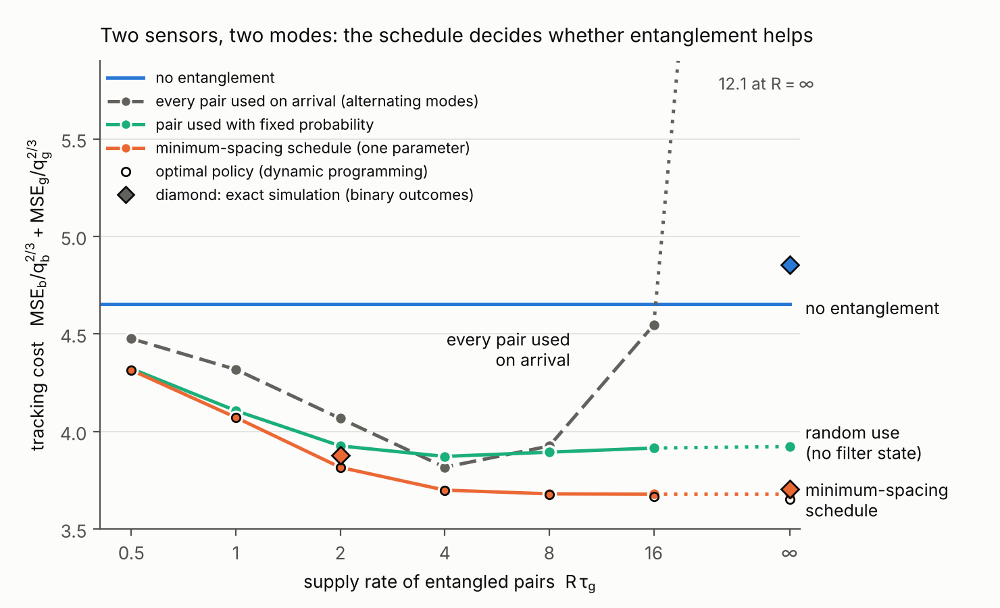

# Toy 3：调度 entanglement，检验 A 的创新点

2026-11-11。接 [toy_model_analysis_zh.md](toy_model_analysis_zh.md)。

问题：A 的创新点是 "filter 的 error covariance 决定纠缠哪些节点、测多久、何时测"。Toy 1 和 toy 2 里只有一种测量可选，这个创新点没有出现。Toy 3 是出现调度的最小模型：两个 sensors，两个 mode 都要跟踪，entangled pairs 限速供给。

## 结论

1. **调度是必需的。** 两个 mode 都要跟踪时，entanglement 不增加总 information，只把它集中到一个 mode 上。Pair 一到就用，供给充足时 cost 是不纠缠的 2.6 倍。调度之后，cost 比不纠缠低 21%（线性 Kalman filter）到 24%（精确模拟）。
2. **增益的来源是 interrogation time 按 mode 分开。** 不纠缠时两个 sensors 的 $T$ 被变化快的 mode 限制。纠缠测量只对一个 mode 敏感，它的 $T$ 只受这个 mode 的不确定度限制，所以慢的 mode 可以用 4 到 5 倍长的 $T$ 来测。
3. **增益的大小由两个 mode 的差异决定。** 两个 mode 的 process noise 之比 $\rho\le10$ 且权重相当时没有增益；$\rho=100$ 时 7%，$\rho=1000$ 时 21%。快的 mode 越不重要，增益越大：它的权重降到 0.1 时 cost 低 49%，降到 0 就是 toy 2 的 2.6 倍。
4. **需要的 entanglement 很少。** 间隔规则每 $\tau_g$ 只用约 2.5 个 pairs，占全部周期的 10% 到 14%。供给速率 $R=1/\tau_g$ 时已拿到 60% 的增益，$R=2/\tau_g$ 时 86%。
5. **调度规则很简单。** 只有一个参数的间隔规则（上一次纠缠测量之后至少隔 $\tau$ 再用下一个 pair）与 dynamic programming 的最优解相差不到 1%。
6. **"用在哪个 mode、何时用" 不需要在线的 covariance feedback。** 精确模拟里，用实时 variance 在线决策的 policy 与离线算好的间隔规则相差 1% 以内；只看一个 variance 的阈值规则比间隔规则差 4.5%。这与经典 sensor scheduling 的结论一致：linear-Gaussian 系统的 error covariance 不依赖测量数据，调度可以离线算出。
7. **"测多久" 必须在线用 covariance。** 每个周期的 $T$ 都由当前的 variance 通过 lock constraint 决定，三个 toy model 都依赖这一点。
8. **对创新点的判断。** "entangled sensors + Kalman filter + 调度" 这个组合成立，调度层决定 entanglement 是有利还是有害。原来的表述里，"在线决定纠缠哪些节点、何时纠缠" 这一半在平稳条件下没有带来可测的增益，建议改写，见第 6 节。

## 1　模型

**信号。** 两个 sensors 的场是 $x_1=b+g$，$x_2=b-g$。$b$ 和 $g$ 是独立的 Wiener processes，$q_b=\rho\,q_g$，$\rho\ge1$，所以 $b$ 是变化快的 mode。时间以 $\tau_g=q_g^{-1/3}$ 为单位。

**Cost。** 两个 mode 各自以自己的尺度归一化：

$$J=\lambda\,\frac{\mathrm{MSE}_b}{q_b^{2/3}}+\frac{\mathrm{MSE}_g}{q_g^{2/3}} .$$

$\lambda=1$ 表示两个 mode 同等重要，$\lambda=0$ 表示 $b$ 只是噪声（toy 2）。

**每个周期可选的测量。**

| 记号 | 测量 | 需要 pair | 对 $b$ 的 information | 对 $g$ 的 information | Lock constraint |
|---|---|---|---|---|---|
| S | 两个 sensors 各自读出 | 否 | $2T^2$ | $2T^2$ | $\mathrm{Var}(\varphi_b)+\mathrm{Var}(\varphi_g)\le c^2$ |
| X | correlation spectroscopy | 否 | 0 | $T^2$ | $4\,\mathrm{Var}(\varphi_g)\le c^2$ |
| B | $(\lvert00\rangle+\lvert11\rangle)/\sqrt2$ | 是 | $4T^2$ | 0 | $4\,\mathrm{Var}(\varphi_b)\le c^2$ |
| G | $(\lvert01\rangle+\lvert10\rangle)/\sqrt2$ | 是 | 0 | $4T^2$ | $4\,\mathrm{Var}(\varphi_g)\le c^2$ |

S、B、G 三种测量的总 information 都是 $4T^2$。Entanglement 把 output matrix 从满秩、增益为 1 换成秩为 1、增益为 2，总量不变。

**Entanglement 的供给。** Pairs 按 Poisson process 到达，速率 $R$，缓存里最多存一个。

**Policy。** 每个周期开始时选一种测量和它的 $T$。比较五种：

- 不纠缠：只用 S 和 X。
- 到达即用：有 pair 就用，全部测 $g$，或者 $b$、$g$ 轮流。
- 按固定概率使用：有 pair 时以固定概率测 $g$，不看 filter 的状态。
- 间隔规则：上一次 G 之后至少过 $\tau$ 才再做一次 G，其余周期用 S。$\tau$ 由线性模型离线算出。
- 最优：对状态 $(P_b,P_g,\text{缓存})$ 做 average-cost dynamic programming。

所有 policy 的 $T$ 都由当前 variance 按 lock constraint 取到上限（$c=0.5$）。

## 2　不调度就没有优势

$\rho=1000$，$\lambda=1$，pairs 不限量：

| Policy | 线性 Kalman filter | 精确模拟 |
|---|---|---|
| 不纠缠 | 4.65 | 4.85 |
| 到达即用，全部测 $g$ | 7127 | |
| 到达即用，$b$ 和 $g$ 轮流 | 12.09 | 12.44 |
| 按固定概率使用 | 3.92 | |
| 间隔规则 | 3.68 | 3.70 |
| 最优（dynamic programming） | 3.65 | 3.74 |

精确模拟一列的 "最优" 是线性模型的 policy 表在精确模拟里按实时 variance 查表使用的结果，精确模型本身的最优 policy 没有算。

**为什么到达即用会变差。** 一次 G 测量的 $T$ 约为 $0.2\,\tau_g$，期间没有任何测量覆盖 $b$，而 $b$ 的特征时间只有 $0.1\,\tau_g$。连续使用 entanglement 时，没被测的那个 mode 的误差按时间的平方增长。

**为什么调度之后变好。** S 测量的 $T$ 被 $b$ 限制在约 $0.045\,\tau_g$，每次只给 $g$ 提供 $2T^2$ 的 information。一次 G 测量的 $T$ 是它的 4 到 5 倍，给 $g$ 的 information 是一次 S 测量的 40 倍左右。隔几个 S 周期插入一次 G，就能用少量时间换来 $g$ 的大部分 information。

**代价。** 调度把误差从 $g$ 移到 $b$：$\mathrm{MSE}_g$ 从 3.36 降到 1.8，$\mathrm{MSE}_b$ 从 1.29 升到 1.9（各自归一化后）。总 cost 下降 21%。

## 3　供给速率

$\rho=1000$，$\lambda=1$，线性 Kalman filter：

| $R\,\tau_g$ | 0 | 0.5 | 1 | 2 | 4 | 8 | 16 | $\infty$ |
|---|---|---|---|---|---|---|---|---|
| 到达即用，全部测 $g$ | 4.65 | 4.32 | 4.11 | 4.12 | 6.09 | 18.2 | 122 | 7127 |
| 到达即用，轮流 | 4.65 | 4.48 | 4.32 | 4.07 | 3.82 | 3.93 | 4.55 | 12.1 |
| 按固定概率使用 | 4.65 | 4.32 | 4.11 | 3.93 | 3.87 | 3.89 | 3.92 | 3.92 |
| 间隔规则 | 4.65 | 4.31 | 4.07 | 3.82 | 3.70 | 3.68 | 3.68 | 3.68 |
| 最优 | 4.65 | 4.32 | 4.07 | 3.82 | 3.70 | 3.68 | 3.67 | 3.65 |

图 4：cost 随 pair 供给速率的变化。蓝线是不纠缠。菱形是精确模拟。

- **到达即用的 cost 随供给增加先降后升。** 供给越充足，不调度的后果越严重。
- **间隔规则在 $R\approx4/\tau_g$ 处饱和。** 再多的 pairs 没有用处。
- **间隔规则与最优解的差距不超过 0.7%。** 差距最大的 $R=\infty$ 处，最优解多用了一些 B 测量。
- **不看 filter 状态的随机使用，在 $R\ge2/\tau_g$ 时比间隔规则差 3% 到 7%。**

## 4　在线 feedback 的价值

线性 Kalman filter 里，$P_g$ 是 "距上一次 G 多久" 的确定函数，所以按 variance 设阈值和按时间设间隔是同一件事，离线就能算出。差别只可能出现在精确模型里：binary outcomes 使 posterior variance 依赖数据。

精确模拟，$\rho=1000$，$\lambda=1$：

| Policy | 用到的在线信息 | $R=\infty$ | $R=2/\tau_g$ |
|---|---|---|---|
| 间隔规则 | 只有时间 | 3.70 | 3.88 |
| $P_g$ 阈值规则 | $g$ 的实时 variance | 3.87 | 3.99 |
| Dynamic programming 的 policy 表 | $b$ 和 $g$ 的实时 variance | 3.74 | 3.86 |

- 在线使用两个 variance 的 policy 与离线的间隔规则相差 1% 以内，在两个 seeds 的波动范围内。
- 只看 $P_g$ 的阈值规则差 3% 到 4.5%。实时 variance 有波动，阈值会连续触发两次 G，$b$ 连续两个长周期没有被测。

这符合经典结果。Linear-Gaussian 系统里 error covariance 的演化不依赖测量数据，最优调度可以事先算出（Meier–Peschon–Dressler 1967），并且可以用周期调度任意逼近（[Zhao et al., IEEE TAC 2014](https://arxiv.org/abs/1312.0157)）。Toy 3 的非线性不足以改变这个结论。

## 5　增益随 $\rho$ 和权重的变化

最优调度（pairs 不限量）与最好的不纠缠 policy 的 cost 之比，线性 Kalman filter：

| $\rho$ | 权重相等（不归一化） | $\lambda=1$ | $\lambda=0.1$ | $\lambda=0.01$ |
|---|---|---|---|---|
| 10 | 1.00 | 1.00 | 0.83 | 0.71 |
| 100 | 0.98 | 0.93 | 0.65 | 0.53 |
| 1000 | 0.95 | 0.79 | 0.51 | 0.46 |

"权重相等" 指 cost 取 $\mathrm{MSE}_b+\mathrm{MSE}_g$，即两个 sensor 位置上场的误差之和。

- **1.00 表示最优解不使用 entanglement。** 两个 mode 相近时，纠缠测量对一个 mode 的好处抵不过另一个 mode 的损失。这是 Proctor–Knott–Dunningham 2018 的结论在跟踪问题里的版本：估计每个节点自己的参数时 entanglement 没有用。
- **不归一化时增益不超过 5%（$\rho\le1000$）。** 这时 cost 几乎全部来自 $b$，问题退化为 toy 1 的 $k=2$。
- **增益大的条件是 cost 集中在少数 mode 上，而且其余 mode 变化快。**

**一般的说法。** 在正交的 mode 坐标里，$k$ 个不纠缠的 sensors 给每个 mode 的 information 都是 $T^2$，一个 $k$-sensor GHZ 给一个 mode 的 information 是 $kT^2$，总量都是 $kT^2$。Entanglement 的优势上限是 "sensor 数除以同一时刻需要测的 mode 数"。Toy 1 是 $k$ 个 sensors 测 1 个 mode，toy 2 是 2 个 sensors 测 1 个 mode，toy 3 是 2 个 sensors 测 2 个 mode。

## 6　对 A 的创新点的判断

**成立的部分。**

- 组合本身成立。多个 mode 的跟踪问题里，entanglement 的优势只有经过调度才出现，不调度会变差。Toy 3 给出了数值。
- "测多久" 必须由 error covariance 在线决定。
- 需要的 entanglement 很少，这与远距离 entanglement 供给不足的现状相容。

**需要改写的部分。**

- "error covariance 在线决定纠缠哪些节点、何时纠缠" 在平稳条件下没有可测的增益。调度可以离线算出，形式是一个周期调度。Control 领域的读者会指出这是 open-loop schedule。
- 调度问题的数学结构是经典的 sensor scheduling，不是新的。

**建议的表述。** A 提出一类新的 sensor scheduling 问题，新的地方有三条：

1. 可选的 output matrices 由 entanglement 的配置给出，秩和增益此消彼长，总 information 不变。
2. 可用的测量集合依赖当前的 error covariance（lock constraint）。经典 sensor scheduling 里测量集合是固定的。
3. 测量消耗一种随机到达的资源。

对应的英文一句话：covariance-aware scheduling of entanglement for tracking a time-varying field, where the error covariance sets the interrogation time online and the allocation of entanglement across modes is designed from the Riccati recursion.

**评分。** 创新性 3，重要性 3，可行性 4，与之前相同。创新性没有上升，因为调度的数学是经典的。重要性没有上升，因为两个 mode 都重要时增益是 20% 到 25%，只有在快的 mode 不重要时才到 2 倍以上。可行性的依据更充分：单参数规则接近最优，需要的 pairs 很少。

**在线 feedback 可能有价值的情形，都没有检验。**

- Process noise 不平稳或未知，例如某个 mode 突然变快。这时需要用 innovation 来调整，error covariance 本身不够。
- 节点多，可纠缠的组合数随节点数指数增长，离线调度算不动。
- Pair 在 memory 里会衰减，存在 "现在用还是等" 的决策。

这三条里第二条最接近 whitepaper 的主题 scalability。下一步建议做 3 到 4 个节点、pairs 在不同 link 之间竞争的模型，看调度的计算量和增益如何随节点数变化。

## 核对深度

- **线性 Kalman filter。** 每个 mode 的 variance 递推与 toy 1 的 integrated-phase model 相同。Dynamic programming 在 $100\times100\times2$ 的网格上做，得到的 policy 再用不依赖网格的递推模拟来评估 cost。
- **精确模拟。** Binary outcomes 加二维 particle filter，每个点 2 个 seeds，每个 seed 64 条轨迹、2500 个周期。间隔规则和到达即用的结果与线性模型相差 3% 以内。
- **不纠缠的 baseline 在精确模拟里更高。** $c=0.5$ 时 4 个 seeds 是 4.82、4.84、4.90、7.81，最后一个出现 phase slip，表中的 4.85 是前三个的平均。$c=0.45$ 时 4 个 seeds 都没有 slip，平均 4.96。调度后的 policy 在所有 seeds 里都没有 slip。
- **X 测量（visibility 为 1/2）在线性模型里偏乐观**，toy 2 里相差 14%。它只在 $\rho=1000$、$\lambda\le0.1$ 的不纠缠 baseline 里被用到，所以第 5 节这两格的增益偏保守。$\lambda<1$ 的情形没有做精确模拟。
- **间隔规则只考虑了 G 测量。** 最优解在 $R\ge8/\tau_g$ 时还使用 B 测量，带来的改进不超过 0.7%。
- **没有建模的因素。** Pair 的衰减，GHZ contrast 小于 1，dephasing，超过两个 sensors 的网络。
- **文献。** Zhao et al. 2014 核对了摘要。Proctor–Knott–Dunningham 2018 在之前的文档里核对过。Meier–Peschon–Dressler 1967（IEEE TAC, "Optimal control of measurement subsystems"）按记忆引用，没有重新核对。

## 复现

代码和数据在 [code/](code/)。

- `toy3_dp.py`：线性模型，dynamic programming，以及各种 policy 的模拟。
- `toy3_exact.py`：精确模拟。
- `run3_sweep.py`：第 3 节的供给速率扫描。`run3_map.py`：第 5 节的表。`run3_exact.py`、`run3_exact2.py`：精确模拟的两轮。
- `make_fig4.py`：生成图 4。
