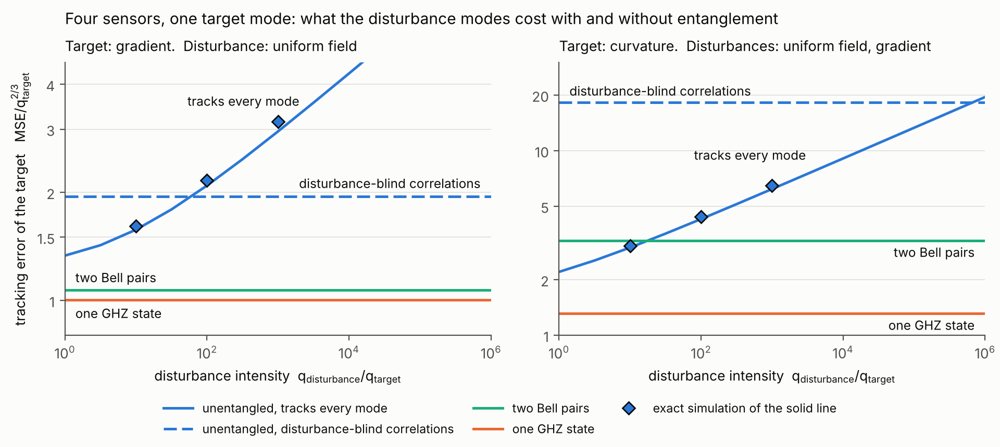
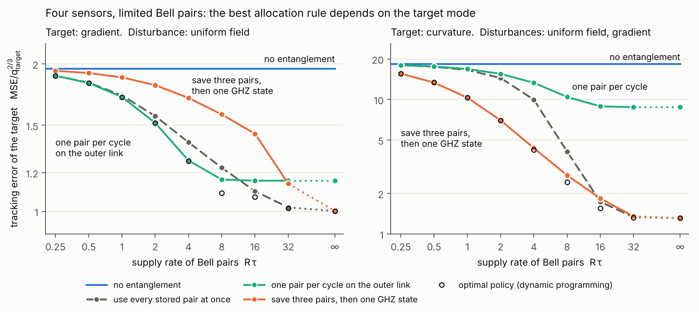

# Toy 4：多个 sensors，一个目标 mode，强而快的干扰 mode

2026-11-12。接 [toy3_scheduling_zh.md](toy3_scheduling_zh.md)。按 problem formulation 的编号，这是 toy model 3。

文中的纠缠都是**网络纠缠**（不同 sensors 之间）。每个 sensor 只有一个 qubit，所以没有局部纠缠。

要检验的猜想：有强干扰 mode 时，纠缠的增益随干扰强度和干扰 mode 的个数增长，超过没有干扰时的水平。另一个问题是 Bell pairs 有限时该怎样分配。

## 结论

1. **猜想对了一半。决定增益的是需要抵消的干扰 mode 的个数，不是干扰强度本身，也不是 sensor 数。**

   | 情形 | 没有干扰 | 干扰很强时的上限 | 干扰强度 1000 倍时 |
   |---|---|---|---|
   | A：目标梯度，干扰均匀分量 | 1.1 到 1.5 倍 | 1.9 到 2.4 倍 | 1.9 到 2.4 倍 |
   | A′：目标梯度，干扰均匀分量和曲率 | 1.3 到 1.5 倍 | 2.8 倍 | 2.8 倍 |
   | B：目标曲率，干扰均匀分量和梯度 | 1.3 到 1.5 倍 | 14 倍（4 个 sensors），7 倍（8 个） | 4.7 倍 |

   表中是"最好的不纠缠方案的 MSE 除以 GHZ 的 MSE"。

2. **原因是不纠缠的 sensors 要靠多个结果的乘积来抵消干扰。** 抵消 1 个干扰 mode 需要 2 个 sensors 的乘积，visibility 是 1/2；抵消 2 个需要 4 个 sensors 的乘积，visibility 是 1/8。Information 正比于 visibility 的平方。GHZ 的符号 pattern 本身就对干扰免疫，visibility 是 1。
3. **通常的 gradiometry（情形 A）增益约 2 倍，而且不随 sensor 数增长。** Sensors 多了以后，不纠缠的 sensors 有很多条基线可以互相校验，测量时间可以取得很长。这个不纠缠的 benchmark 比之前估计的强。
4. **部分纠缠有清楚的规律。**
   - 情形 B：每多用一个 pair，information 乘 4。4 个 sensors 用 0、1、2、3 个 pairs 时 MSE 是 18.2、8.8、3.3、1.3。
   - 情形 A：第一个 pair 放在最长的基线上就拿到大部分收益，MSE 从 1.95 降到 1.16，全部纠缠成 GHZ 是 1.00。
   - 纠缠错了位置比不纠缠还差：情形 A 里把 pair 放在相邻的两个 sensors 上，information 从 1.34 降到 0.56。
5. **Pairs 有限时，最好的分配规则取决于目标 mode，两种情形正好相反。**
   - 情形 A：每个周期用一个 pair，放在最长基线上。攒 pairs 做 GHZ 明显更差。
   - 情形 B：攒够 3 个 pairs 再做一次 GHZ。一个一个地用几乎没有收益。
   - 两个简单规则在供给不多时都与 dynamic programming 的最优解重合。
6. **对方向的判断。** 网络纠缠最有说服力的应用是"目标是高阶 mode、同时有两个以上强干扰 mode"，对应不屏蔽环境里的二阶 gradiometer。评分见第 6 节。

## 1　模型

**Sensors 和 modes。** $k$ 个 sensors 等间距排在一条线上，位置 $z_j\in[-1,1]$。场有三个 modes：

$$f_b=1\ (\text{均匀分量}),\qquad f_g=z\ (\text{梯度}),\qquad f_c=z^2-\overline{z^2}\ (\text{曲率}).$$

三个 modes 在 sensor 位置上互相正交。每个 mode 的系数是独立的 random walk，目标 mode 的强度是 1，干扰 mode 的强度是 $\rho$。Cost 只算目标 mode 的时间平均 MSE，以 $q_{\text{target}}^{2/3}$ 为单位；时间以目标的特征时间 $\tau$ 为单位。

**三种情形。**

| 情形 | 目标 | 干扰 | 对应的应用 |
|---|---|---|---|
| A | 梯度 | 均匀分量 | 一阶 gradiometer。$k=2$ 就是之前的 toy 2 |
| A′ | 梯度 | 均匀分量、曲率 | 同上，多一个偶数阶的干扰 |
| B | 曲率 | 均匀分量、梯度 | 二阶 gradiometer：远处的源既有均匀分量也有梯度，近处的源才有明显的曲率 |

二阶 gradiometer 是不屏蔽环境里测心磁的常用做法，例如 [APL 2000](https://doi.org/10.1063/1.125625) 的 SQUID 二阶 gradiometer。静态版本的纠缠实验是 [Bate et al., PRL 2025](https://arxiv.org/abs/2501.08940)：3 个离子，目标是二次项，常数和梯度是干扰。

**四种测量。**

| 测量 | 用到的纠缠 | 怎样对付干扰 |
|---|---|---|
| 不纠缠，跟踪全部 modes | 无 | Filter 同时跟踪干扰 mode。$T$ 被最快的 mode 限制 |
| 不纠缠，免疫干扰的 correlation | 无 | 不跟踪干扰，干扰的 phase 完全随机。只有对干扰免疫的结果乘积带有目标的信息。这是 correlation spectroscopy 推广到 $k$ 个 sensors |
| Bell pairs | 镜像位置的 sensors 两两纠缠，$k/2$ 个 pairs | 情形 A：每对是 $(\lvert01\rangle+\lvert10\rangle)/\sqrt2$，自己就免疫。情形 B：每对是 $(\lvert00\rangle+\lvert11\rangle)/\sqrt2$，免疫梯度，再把两对的结果相乘来抵消均匀分量 |
| GHZ | 全部 sensors 一个态，$k-1$ 个 pairs | 符号 pattern 使它免疫所有干扰。情形 A 是 $(-,-,+,+)$，情形 B 是 $(+,-,-,+)$ |

**统一的描述。** 把 sensors 分成 $G$ 组，每组是一个带符号 pattern 的 GHZ 态，不纠缠的 sensor 自己是一组。每组读出一个 $\pm1$。对随机的干扰 phase 求平均后，结果的联合分布是

$$P(m\mid d)=2^{-G}\Big[1+\sum_{\varepsilon}\chi_\varepsilon(m)\,\mathrm{Re}\big(c_\varepsilon\,e^{i(A_\varepsilon d+D_\varepsilon)}\big)\Big],$$

求和只包括对干扰免疫的组合 $\varepsilon\in\{-1,0,1\}^G$，$d$ 是目标的 phase 与 feedback phase 之差，$A_\varepsilon$ 是这个组合对目标的增益。一个含 $s$ 组的组合，振幅是 $2^{-(s-1)}$。精确模拟直接用这个分布，不做线性化。

**Lock 参数。** 之前的 toy model 统一用 $c=0.5$。这里每种测量各自扫 $c$，取 MSE 最小的值，phase slip 造成的误差计入平均。这样对各方都公平。

## 2　每个周期对目标的 information

单位是 $T^2$。不纠缠的两列取最优的 reference phases。

| 情形 | $k$ | 不纠缠，跟踪全部 | 不纠缠，免疫干扰 | Bell pairs | GHZ |
|---|---|---|---|---|---|
| A | 2 | 2 | 1 | 4 | 4 |
| A | 4 | 2.22 | 1.34 | 4.44 | 7.11 |
| A | 8 | 3.43 | 2.41 | 6.86 | 20.9 |
| A′ | 4 | 2.22 | 1.11 | 4.44 | 7.11 |
| A′ | 8 | 3.43 | 1.73 | 6.86 | 20.9 |
| B | 4 | 0.79 | 0.049 | 0.79 | 3.16 |
| B | 8 | 1.12 | 0.164 | 1.33 | 6.82 |

- **"不纠缠，跟踪全部" 这一列只在干扰被 filter 跟住时才拿得到。** 干扰越强，$T$ 越短，这一列乘上的 $T^2$ 越小。
- **情形 A：不纠缠也能免疫干扰，代价不大。** 任意两个 sensors 的结果相乘就消去了均匀分量，visibility 是 1/2。$k$ 个 sensors 有 $k(k-1)/2$ 对，所以免疫干扰的 information 是跟踪全部时的 50% 到 70%。
- **情形 B：不纠缠时免疫干扰的代价是 64 倍。** 同时消去均匀分量和梯度的最小组合是 4 个 sensors 的乘积 $(+,-,-,+)$，visibility 是 1/8。4 个 sensors 时只有这一个组合，information 是 GHZ 的 $1/64$。
- **情形 B 的规律：$K=a^2\cdot4^{-(G-1)}$。** $a$ 是 GHZ 对目标的增益，$G$ 是组数。4 个 sensors 时，不论 pair 放在哪条 link 上，每合并两组，information 乘 4：0.049、0.198、0.79、3.16。
- **情形 A 的规律：基线长度决定价值。** 4 个 sensors 的各种配置：

  | 配置 | 用掉的 pairs | Information |
  |---|---|---|
  | 不纠缠 | 0 | 1.34 |
  | 一个 pair，放在相邻的两个 sensors 上 | 1 | 0.56 |
  | 一个 pair，放在中间两个 sensors 上 | 1 | 1.44 |
  | 一个 pair，放在最外侧两个 sensors 上 | 1 | 4.11 |
  | 两个 pairs，各自连接相邻的 sensors | 2 | 1.78 |
  | 两个 pairs，镜像位置 | 2 | 4.44 |
  | GHZ | 3 | 7.11 |

  一个纠缠对只对两个 sensors 的差敏感。放在相邻 sensors 上，基线只有 2/3，而且这两个 sensors 原来与远处 sensors 的长基线 correlation 没有了，所以比不纠缠还差。

## 3　干扰很强时的跟踪误差

精确模拟。干扰强到不纠缠的 sensors 跟不住，只能用免疫干扰的 correlation。

| 情形 | $k$ | 不纠缠 | Bell pairs | GHZ | 不纠缠 / GHZ |
|---|---|---|---|---|---|
| A | 2 | 2.96 | | 1.21 | 2.4 |
| A | 4 | 1.95 | 1.07 | 1.00 | 1.9 |
| A | 8 | 1.29 | 0.88 | 0.70 | 1.9 |
| A′ | 4 | 2.76 | 1.07 | 1.00 | 2.8 |
| A′ | 8 | 1.93 | 0.88 | 0.70 | 2.8 |
| B | 4 | 18.2 | 3.26 | 1.31 | 14 |
| B | 8 | 7.3 | 2.01 | 1.02 | 7.2 |

- **情形 A 的增益约 2 倍，不随 $k$ 增长。** $k$ 从 2 到 8，比值从 2.4 降到 1.9。
- **不纠缠的 benchmark 为什么比预想的强。** 多条不同长度的基线一起消除了 fringe 的歧义，短基线负责定位，长基线负责精度。$k=8$ 时最优的 $T$ 是原来规则（最长基线的 lock constraint，$c=0.5$）给出的 6 到 8 倍。按原来的规则（$c=0.5$）算，$k=8$ 的不纠缠误差是 2.47，放开之后是 1.29。$k=2$ 只有一条基线，没有这个效应，最优仍在 $c=0.5$。
- **情形 A 里两个 Bell pairs 已经接近 GHZ。** $k=4$ 时是 1.07 对 1.00。只用最外侧的一个 pair 是 1.16。
- **情形 B 的增益是 7 到 14 倍，而且 Bell pairs 和 GHZ 差得多。** $k=4$ 时两个 Bell pairs 是 3.26，GHZ 是 1.31。
- **8 个不纠缠的 sensors 仍不如 4 个纠缠的。** 情形 A：1.29 对 1.07（两个 Bell pairs）。情形 B：7.3 对 1.31（GHZ）。

## 4　干扰强度有限时

不纠缠的 sensors 有两个选择，取较好的一个：跟踪全部 modes（线性 Kalman filter），或者用免疫干扰的 correlation（第 3 节）。跟踪全部 modes 时误差按 $\rho^{1/6}$ 增长。

图 5：4 个 sensors。蓝色实线是不纠缠、跟踪全部 modes；蓝色虚线是不纠缠、免疫干扰的 correlation；两者中较低的一条是不纠缠的 benchmark。菱形是实线的精确模拟。

最好的不纠缠方案与 GHZ 的 MSE 之比：

| 情形 | $k$ | $\rho=0$ | 10 | 100 | 1000 | $10^4$ | $\rho\to\infty$ |
|---|---|---|---|---|---|---|---|
| A | 2 | 1.1 | 1.4 | 1.9 | 2.4 | 2.4 | 2.4 |
| A | 4 | 1.3 | 1.6 | 1.9 | 1.9 | 1.9 | 1.9 |
| A | 8 | 1.5 | 1.8 | 1.9 | 1.9 | 1.9 | 1.9 |
| A′ | 4 | 1.3 | 1.7 | 2.3 | 2.8 | 2.8 | 2.8 |
| B | 4 | 1.3 | 2.3 | 3.2 | 4.7 | 6.9 | 14 |
| B | 8 | 1.5 | 2.4 | 3.3 | 4.8 | 7.0 | 7.2 |

- **情形 A 很早就饱和。** 饱和点在 $k=4$ 时是 $\rho\approx60$，$k=2$ 时约 400，$k=8$ 时约 15。超过这个强度，不纠缠的 sensors 改用免疫干扰的 correlation，误差不再增长。
- **情形 B 一直增长到 $\rho\sim10^6$（$k=4$）。** 免疫干扰的 correlation 太弱，不纠缠的 sensors 只能硬跟干扰。$\rho=1000$ 时增益 4.7 倍，$k=4$ 和 $k=8$ 相同。
- **没有干扰时的增益只有 1.1 到 1.5 倍**，就是上一轮讨论的 information 上限经过 $\mathcal I^{-1/3}$ 之后的值。

## 5　Pairs 有限时怎样分配

4 个 sensors。Bell pairs 按 Poisson process 到达，速率 $R$，最多存 3 个，可以送到任意一条 link，$k-G$ 个 pairs 把 sensors 合并成 $G$ 组。每个周期选一个配置（用 0、1、2 或 3 个 pairs）和 $T$。

这一节用线性 Kalman filter，每个配置的 information 按第 3 节的精确模拟校准。前两张表假设干扰很强，没有 pair 时用免疫干扰的 correlation。

图 6：空心圈是 dynamic programming 的最优 policy，状态是（目标的 variance，存着的 pairs 数）。

**情形 A（目标梯度）。**

| $R\,\tau$ | 0.5 | 1 | 2 | 4 | 8 | 16 | $\infty$ |
|---|---|---|---|---|---|---|---|
| 存着多少用多少 | 1.83 | 1.73 | 1.57 | 1.38 | 1.23 | 1.10 | 1.00 |
| 每周期一个 pair，放最外侧 | 1.83 | 1.71 | 1.52 | 1.27 | 1.16 | 1.16 | 1.16 |
| 攒够 3 个做 GHZ | 1.92 | 1.88 | 1.81 | 1.71 | 1.58 | 1.44 | 1.00 |
| 最优 | 1.83 | 1.71 | 1.52 | 1.27 | 1.09 | 1.07 | 1.00 |

不纠缠是 1.96。$R\le4/\tau$ 时最优 policy 就是"每周期一个 pair，放最外侧"。$R=2/\tau$ 时已拿到一半的收益。供给更多时最优 policy 改成每周期两个 pairs，$R\ge32/\tau$ 才用 GHZ。

**情形 B（目标曲率）。**

| $R\,\tau$ | 0.5 | 1 | 2 | 4 | 8 | 16 | $\infty$ |
|---|---|---|---|---|---|---|---|
| 存着多少用多少 | 17.5 | 16.6 | 14.5 | 10.0 | 4.10 | 1.73 | 1.31 |
| 每周期一个 pair | 17.6 | 16.9 | 15.5 | 13.3 | 10.5 | 8.90 | 8.77 |
| 攒够 3 个做 GHZ | 13.4 | 10.3 | 7.01 | 4.35 | 2.73 | 1.84 | 1.31 |
| 最优 | 13.4 | 10.3 | 6.99 | 4.22 | 2.43 | 1.56 | 1.31 |

不纠缠是 18.4。$R\le16/\tau$ 时最优 policy 只用两种配置：不纠缠，以及 GHZ。$R\le2/\tau$ 时"攒够再用"与最优解重合；$R$ 更大时比最优解高 3% 到 18%，差别来自最优解还调整了 $T$。

**为什么相反。** 情形 A 里 information 对 pairs 数是先陡后平的（1.34、4.11、4.44、7.11），第一个 pair 最值钱，所以应该分散到每个周期。情形 B 里每个 pair 乘 4（0.049、0.198、0.79、3.16），最后一个 pair 最值钱，所以应该集中使用。

**干扰强度有限时的情形 B。** $\rho=1000$ 时不纠缠的 sensors 跟踪全部 modes 更好（6.2）。这时的做法是平时不纠缠、跟踪干扰，攒够 3 个 pairs 插入一次 GHZ 测量。GHZ 周期里干扰没人测，之后几个周期的 $T$ 会变短，模拟里包含了这个代价。

| $R\,\tau$ | 0 | 0.5 | 1 | 2 | 4 | 8 | 16 | $\infty$ |
|---|---|---|---|---|---|---|---|---|
| $\rho=100$ | 4.26 | 4.05 | 3.85 | 3.49 | 2.90 | 2.09 | 1.46 | 1.31 |
| $\rho=1000$ | 6.20 | 5.71 | 5.27 | 4.50 | 3.36 | 2.16 | 1.45 | 1.31 |
| $\rho=10^4$ | 9.06 | 7.99 | 7.06 | 5.58 | 3.73 | 2.19 | 1.44 | 1.31 |

$\rho=1000$、$R=2/\tau$ 时，只有 2.3% 的周期是 GHZ，MSE 从 6.2 降到 4.5。$R=8/\tau$ 时降到 2.2。

**与 toy 3 的关系。** 这里的分配规则只依赖存着的 pairs 数，不依赖 filter 的 error covariance，离线就能定下来。这与 toy 3 的结论一致："测多久"由 covariance 在线决定，"怎样分配纠缠"可以离线设计。新的内容是分配规则的形式由 mode 的结构决定。

## 6　对方向的判断

**猜想的修正。** 增益不是随干扰强度无限增长，而是由两件事决定：

1. 需要抵消几个干扰 mode。抵消 1 个，不纠缠的损失是常数倍，增益约 2 倍。抵消 2 个，不纠缠的 visibility 掉到 1/8，增益 5 到 14 倍。
2. 干扰是否强到不纠缠的 sensors 跟不住。情形 A 的门槛是 $\rho\approx60$（$k=4$），情形 B 里增益随 $\rho^{1/6}$ 一直涨到 $\rho\sim10^6$（$k=4$）。

Sensor 数不是有利因素。Sensors 多了，不纠缠的方案也变强，情形 B 的上限从 14 倍降到 7 倍。

**对 whitepaper 的含义。**

- **主打的例子应该是情形 B。** 目标是高阶 mode，干扰是两个低阶 mode。4 个 sensors、$\rho=1000$ 时 MSE 低 4.7 倍，这是目前所有 toy model 里网络纠缠最大的优势。8 个不纠缠的 sensors 也追不上 4 个纠缠的。
- **通常的 gradiometry（情形 A）只有约 2 倍。** 一个放在最长基线上的 Bell pair 就够了，不需要多节点的 GHZ。这种情形下"网络"的必要性弱。
- **调度的内容变成了分配。** 需要回答的是 pair 放在哪条 link 上、分散用还是攒着用。答案由 mode 的结构决定，可以离线算出，简单规则接近最优。纠缠放错位置比不纠缠还差，这一点说明分配不是可有可无的。
- **"由 error covariance 在线决定纠缠哪些节点" 仍然没有证据。** 在线用到的只有 $T$ 和存着的 pairs 数。

**评分。**

| 版本 | 创新性 | 重要性 | 可行性 |
|---|---|---|---|
| 以情形 A 为主（一阶 gradiometry） | 3 | 3 | 4 |
| 以情形 B 为主（高阶 mode，多个干扰） | 3 | 4 | 3 |

- 创新性不变。静态版本里"对噪声免疫的纠缠态保持精度、separable 态损失精度"已有 [Sekatski–Wölk–Dür 2020](https://arxiv.org/abs/1905.06765) 的理论和 Bate 2025 的实验。这里新的是跟踪时变信号的数值、部分纠缠的规律和 pairs 的分配规则。
- 情形 B 的重要性提到 4，因为优势是 5 倍以上，而且不纠缠的方案靠增加 sensors 补不回来。
- 情形 B 的可行性降到 3，因为它需要 4 个节点的 GHZ，或者能存住 3 个 pairs 的 memory。

**下一步的两个候选。**

1. 把干扰 mode 的强度设成不相等（均匀分量强，梯度弱），看"跟踪一部分干扰、免疫另一部分"的混合方案。这是不纠缠 benchmark 里还没有覆盖的一块。
2. 加入 dephasing 和 pair 在 memory 里的衰减。情形 B 的"攒够再用"依赖 memory，这是它可行性的关键。

## 核对深度

- **精确模拟。** 目标 mode 的一维 particle filter，似然是第 1 节的精确分布，干扰 phase 已解析地平均掉。每个点 2 个 seeds，每个 seed 64 条轨迹、2000 个周期。$k=2$ 的不纠缠结果（$c=0.5$ 时 2.96）与 toy 2 的 3.05 一致。两个 seeds 一般相差 1% 到 3%；情形 B、$k=4$ 的不纠缠一格相差 15%（16.8 和 19.7），表中的 18.2 是平均。
- **GHZ 的数值来自单 fringe 的标度关系** $J=J_1a^{-2/3}$。$J_1$ 重新扫了 $c$：$c=0.5$ 的 4 个 seeds 里有 1 个出现 phase slip（1.85、1.85、1.85、2.60），$c=0.45$ 没有 slip，$J_1=1.93$。本文用 1.93。之前的 toy model 用 $c=0.5$ 且不含 slip 的 1.86，纠缠一方的数值比这里低 4%；toy 2 的 2.6 倍按这里的口径是 2.4 倍。
- **不纠缠、免疫干扰的 benchmark。** 态是 $\lvert+\rangle^{\otimes k}$，每个 sensor 单独读出。Reference phases 用两种方式优化（$d=0$ 处的 Fisher information，以及对宽 prior 平均的 Fisher information），$c$ 从 0.35 扫到 2.8 或 4，取最好的。没有证明它是所有不纠缠方案里最优的：没有考虑每个周期更换 reference phases、各 sensor 用不同的 $T$、sensor 位置不等间距。
- **不纠缠、跟踪全部 modes 的 benchmark 用线性 Kalman filter。** $k=4$ 的精确模拟（情形 A 用二维、情形 B 用三维 particle filter）比线性模型高 2% 到 7%，所以第 4 节有限 $\rho$ 处的增益偏保守。
- **混合方案没有算。** 两个干扰 mode 强度相同时，"跟踪一个、免疫另一个"的 $T$ 与跟踪全部时相近，而 information 少到 1/4，不会更好。强度不同时它可能更好，见下一步。
- **第 5 节是线性模型。** 每个配置的 information 校准到它在精确模拟里的稳态误差，配置之间切换的过程没有做精确模拟。前两张表里不纠缠的基准是 1.96 和 18.4，与第 3 节的 1.95 和 18.2 相差不到 1%，来自 reference phases 的两种取法。
- **$k=8$ 情形 B 的 GHZ pattern** 取"外侧一半为正、内侧一半为负"，没有搜索更好的 pattern。
- **没有建模的因素。** Dephasing（GHZ 越大衰减越快），GHZ contrast 小于 1，pair 的衰减和融合的损耗，sensor 位置误差造成的干扰泄漏，干扰 mode 多于模型里的两个。
- **文献。** APL 2000 只核对了标题。Bate 2025 和 Sekatski–Wölk–Dür 2020 在之前的文档里核对过摘要。

## 复现

代码和数据在 [code/](code/)。

- `toy4_modes.py`：配置、精确似然、Fisher information、精确模拟、线性模型。
- `toy4_supply.py`：pairs 有限时的 dynamic programming 和 policy 模拟。
- `run_t4_fisher.py`：第 2 节的表。`run_t4_exact.py`、`run_t4_exact2.py`、`run_t4_exact3.py`、`run_t4_fringe.py`：精确模拟。`run_t4_S.py`：跟踪全部 modes 的精确核对。`run_t4_lin.py`：线性模型的 $\rho$ 扫描。`run_t4_supply.py`、`run_t4_mixed.py`：第 5 节。
- `t4_summary.py`：汇总成 `res_t4_summary.json`。`make_fig5.py`、`make_fig6.py`：画图。
