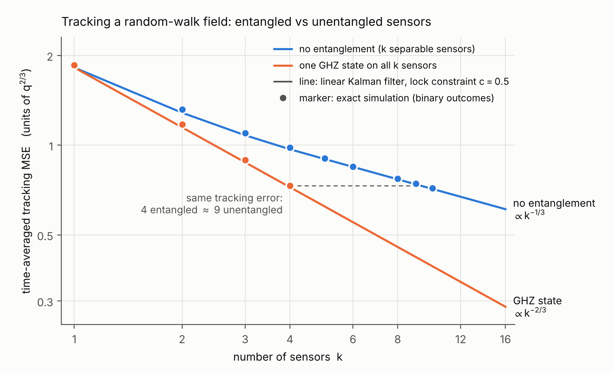
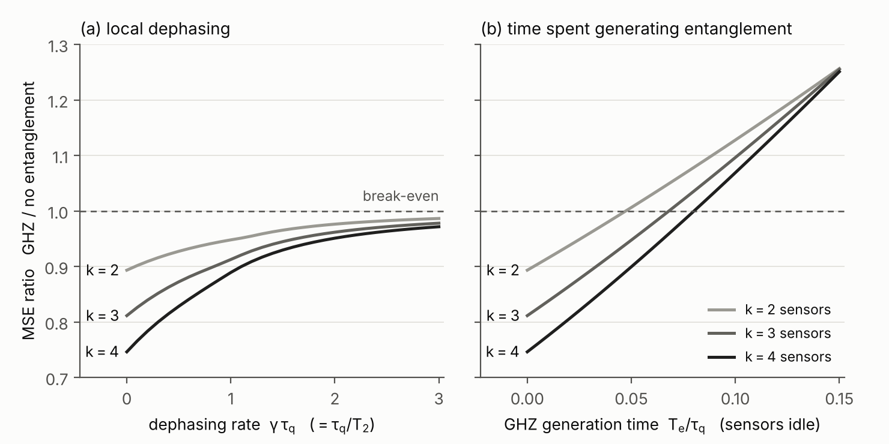
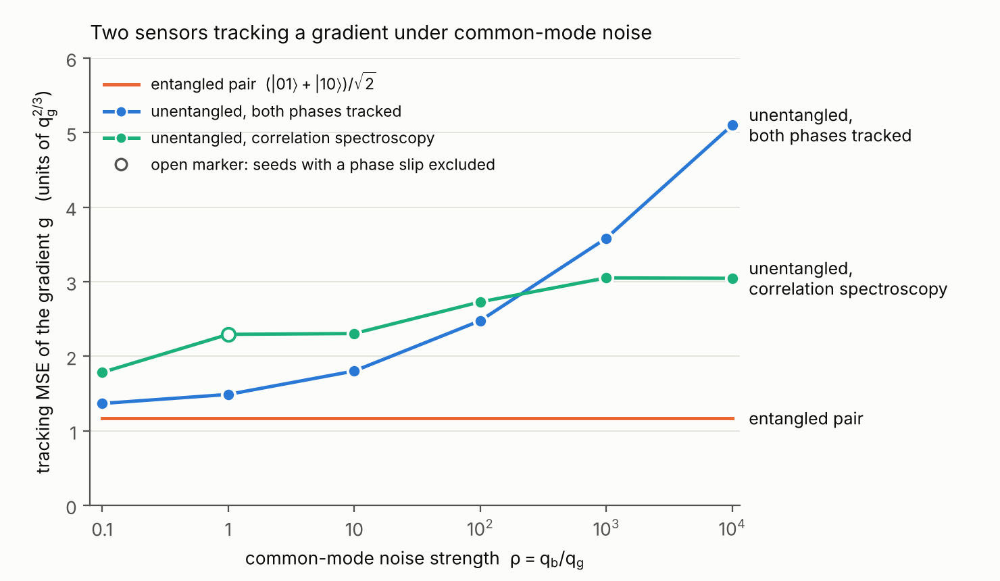

# Toy model：entangled sensor network 相对 unentangled network 的优势

2026-11-10。接 [claude_entangled_sensor_prior_art_zh.md](../literature/claude_entangled_sensor_prior_art_zh.md)。

问题：用最简单的模型说明，用 Kalman filter 跟踪时变场时，共享 entanglement 的 sensor network 比不共享的有优势。采用完全中心化的版本：所有 outcomes 送到一个 coordinator，由它运行 filter 并给出 feedback。

## 结论

1. **有优势，精度和资源两种都有。** $k$ 个 sensors 跟踪同一个 random-walk 场时，tracking MSE 在不纠缠时按 $k^{-1/3}$ 下降，共享一个 GHZ state 时按 $k^{-2/3}$ 下降。
2. **少量 sensors 时，精度优势是中等的。** $k=2,3,4$ 时 GHZ 的 MSE 分别低 11%、19%、26%。
3. **按资源算，优势更大。** 达到同样的 MSE，不纠缠的网络需要约 $0.6k^2$ 个 sensors。3 个纠缠的 sensors 相当于 5 个不纠缠的，4 个相当于 9 个。
4. **小规模下优势最大的场景是带 common-mode 噪声的 gradient 跟踪。** 两个 sensors 就够。纠缠对的 MSE 不随 common-mode 噪声变化；不纠缠时 MSE 最高是它的 2.6 倍，要 5 对不纠缠的 sensors 才能追平 1 对纠缠的。
5. **Kalman filter 的预测是使用 entanglement 的前提。** GHZ 的 fringe 窄 $k$ 倍，只有用 filter 的 one-step prediction 做 feedback，测量才留在可用区间。这是 entangled sensors 和 Kalman filter 需要闭环的具体原因。
6. **优势有三个条件。** Coherence time 不短于信号的特征时间 $\tau_q$；entanglement 的供给速率乘以 coherence time 不小于约 5；GHZ contrast 不低于 0.8 到 0.9。
7. **新旧划分。** 第 1 到 3 条的模型与 atomic clock 的 local-oscillator 锁定相同，结论与该领域的已知结果一致。第 4 条是 correlation spectroscopy 实验的时变版本。这份分析新增的是把它们写成 Kalman filter 的 tracking MSE，并给出数值和适用条件。A 自己的创新点（用 error covariance 调度 entanglement）在这两个模型里还没有出现，第 6 节给出能体现它的下一个模型。

## 1　模型

**信号。** 标量场 $x(t)$ 是 Wiener process，$dx=\sqrt q\,dW$。$x$ 以角频率为单位（磁场乘以 gyromagnetic ratio）。$q$ 给出唯一的时间尺度 $\tau_q=q^{-1/3}$。下文时间以 $\tau_q$ 为单位，MSE 以 $q^{2/3}$ 为单位。

**测量。** 每个周期做一次 Ramsey interrogation，时长 $T$。Sensor 积累 phase $\varphi=\int_t^{t+T}x(s)\,ds$。读出前 coordinator 加上 feedback phase $\hat\varphi=T\hat x$，$\hat x$ 是 filter 的预测。$\kappa$ 个共享 GHZ state 的 sensors 给出一个 binary outcome $m=\pm1$：

$$P(m)=\tfrac12\big[1+mV\sin\kappa(\varphi-\hat\varphi)\big],\qquad V=v_0\,e^{-\kappa\gamma T}.$$

$\gamma$ 是每个 sensor 的 dephasing rate（$T_2=1/\gamma$），$v_0$ 是 GHZ 的 contrast。

**两种网络。**

- 不纠缠：每个周期 $k$ 个 outcomes，每个 $\kappa=1$。
- 纠缠：每个周期 1 个 outcome，$\kappa=k$。

**线性化的 measurement equation。** 当 $\kappa(\varphi-\hat\varphi)\ll1$：

$$y=\kappa V(\varphi-\hat\varphi)+v,\qquad \mathrm{Var}(v)\approx1 .$$

每个周期的 information 是 $\mathcal I=\sum_j\kappa_j^2V_j^2$。$V=1$ 时，不纠缠 $\mathcal I=k$，GHZ $\mathcal I=k^2$。Entanglement 改变的是 output matrix：同一批 sensors，从 $k$ 个增益为 1 的测量换成 1 个增益为 $k$ 的测量。

**Lock constraint。** Measurement function 对 $\varphi$ 是周期的，线性化只在 fringe 的单调区间内成立：

$$\kappa_{\max}\,\sigma_\varphi\le c,\qquad \sigma_\varphi^2=\mathrm{Var}(\varphi-\hat\varphi)=T^2P^{+}+\tfrac13qT^3 .$$

$P^+$ 是 posterior variance。模拟给出 $c\approx0.5$。$c\ge0.6$ 时 filter 会锁到错误的 fringe（phase slip），MSE 成倍变大。这个约束说明：能用多长的 $T$、多大的纠缠规模 $\kappa$，由 error covariance 决定。

**性能指标。** Causal estimate 的时间平均 MSE，$J=\lim_{\tau\to\infty}\frac1\tau\int_0^\tau E\big[(x-\hat x)^2\big]dt$，包含两次测量之间的误差增长。

**Policy。** 每个周期按 filter 当前的 variance 选 $T$，使 $\kappa_{\max}\sigma_\varphi=c$。两种网络用同一类 policy。

## 2　解析结果

**Sampled model。** 把一个周期内的场看成常数，$\varphi\approx Tx$：

$$x_{n+1}=x_n+w_n,\quad w_n\sim N(0,qT);\qquad y_n=x_n+v_n,\quad v_n\sim N(0,r),\quad r=\frac{1}{T^2\mathcal I}.$$

Riccati equation 的稳态解和时间平均 MSE：

$$P^+=\tfrac12\Big(\sqrt{(qT)^2+4rqT}-qT\Big),\qquad J=P^++\tfrac12qT=\tfrac12\sqrt{(qT)^2+\frac{4q}{\mathcal IT}}\,.$$

$\gamma=0$ 时对 $T$ 取最小：

$$T^*=\Big(\frac{2}{\mathcal Iq}\Big)^{1/3},\qquad J^*=\frac{\sqrt3}{2^{2/3}}\,q^{2/3}\,\mathcal I^{-1/3}\approx1.09\,q^{2/3}\,\mathcal I^{-1/3}.$$

**Integrated-phase model。** 保留周期内场的变化，state 取 $(x,\varphi)$，稳态 Riccati equation 数值求解。指数不变，常数变为

$$J^*=1.54\,q^{2/3}\,\mathcal I^{-1/3},\qquad T^*=0.90\,(\mathcal Iq)^{-1/3}.$$

后面的数值都用这个模型。

**推论。**

- **Scaling。** 不纠缠 $J\propto k^{-1/3}$，GHZ $J\propto k^{-2/3}$。
- **指数是 1/3 的原因。** 估计静态参数时，variance 与 information 成反比。跟踪时变信号时，多出来的 information 一部分用来缩短 $T$，所以 $J\propto\mathcal I^{-1/3}$：information 翻倍，MSE 只降 21%。这对经典和量子 sensors 都成立。因此少量 sensors 时 MSE 的差距不大，换算成 sensor 数量则是平方关系。
- **GHZ 的严格 scaling。** 无噪声的 $k$-sensor GHZ 与一个 coupling 为 $k$ 的单个 sensor 完全等价，包括非线性部分。所以 $J_{\rm GHZ}(k)=C_1k^{-2/3}q^{2/3}$ 严格成立，$C_1$ 是单个 sensor 的 MSE。模拟给出 $C_1=1.86$。
- **Lock constraint 的代价。** GHZ 始终工作在 lock constraint 上，MSE 比不受约束的线性结果高 $1.86/1.54=1.21$ 倍。不纠缠的网络在 $k\ge5$ 时不受这个约束。
- **等效 sensor 数。** $1.54\,n^{-1/3}=1.86\,k^{-2/3}$ 给出 $n\approx0.57k^2$。

## 3　数值结果：$k$ 个 sensors 测同一个场

精确模拟：真实的 binary outcomes 加 particle filter，$c=0.5$，$\gamma=0$，$v_0=1$。

| $k$ | 不纠缠的 MSE | GHZ 的 MSE | 比值 | 线性 Kalman filter 的比值 | 同样 MSE 需要的不纠缠 sensors |
|---|---|---|---|---|---|
| 1 | 1.857 | 1.857 | 1 | 1 | 1 |
| 2 | 1.315 | 1.173 | 0.89 | 0.89 | 2.6 |
| 3 | 1.096 | 0.890 | 0.81 | 0.81 | 5.2 |
| 4 | 0.982 | 0.731 | 0.74 | 0.75 | 9.4 |
| 8 | 0.771 | 0.464 | 0.60 | 0.59 | 约 37 |
| 16 | 0.609 | 0.292 | 0.48 | 0.47 | 约 146 |

$k=8,16$ 的 GHZ 值来自严格 scaling $C_1k^{-2/3}$。$k=16$ 的不纠缠值来自线性 Kalman filter。其余是直接模拟。$k\ge5$ 的不纠缠网络不受 lock constraint 限制，用它自己的最优 $T$（对应 $c<0.5$）。

图 1：tracking MSE 随 sensor 数的变化。线是带 lock constraint 的线性 Kalman filter，点是精确模拟。虚线表示 4 个纠缠的 sensors 与约 9 个不纠缠的 sensors 误差相同。

**部分纠缠介于两者之间。** 4 个 sensors 的不同分组（$c=0.5$）：

| 分组 | (1,1,1,1) | (2,1,1) | (2,2) | (3,1) | (4) |
|---|---|---|---|---|---|
| MSE | 0.982 | 0.944 | 0.828 | 0.848 | 0.731 |

放宽 $c$ 后 (3,1) 最好到 0.817，(2,1,1) 最好到 0.898，仍不如一个 4-sensor GHZ。

### 3.1　Dephasing

GHZ 的 coherence 以 $k\gamma$ 衰减。MSE 比值随 $\gamma\tau_q=\tau_q/T_2$ 的变化（线性 Kalman filter，$c=0.5$；括号内是精确模拟）：

| $\tau_q/T_2$ | $k=2$ | $k=3$ | $k=4$ |
|---|---|---|---|
| 0 | 0.89 | 0.81 | 0.75 |
| 0.3 | 0.92 (0.93) | 0.85 (0.86) | 0.80 (0.80) |
| 1 | 0.95 (0.95) | 0.91 (0.92) | 0.89 (0.90) |
| 3 | 0.99 | 0.98 | 0.97 |

$T_2=\tau_q$ 时，$k=4$ 的增益从 25% 降到 11%。$T_2\ll\tau_q$ 时比值趋于 1，即 Huelga et al. 1997 的结论：信号慢于 coherence time 时 GHZ 没有增益。

### 3.2　Entanglement 的生成时间

设生成一个 GHZ 需要时间 $T_e$，期间 sensors 不能测量，不纠缠的网络没有这段空闲。MSE 比值（线性 Kalman filter，$c=0.5$）：

| $T_e/\tau_q$ | $k=2$ | $k=3$ | $k=4$ |
|---|---|---|---|
| 0 | 0.89 | 0.81 | 0.75 |
| 0.025 | 0.95 | 0.88 | 0.82 |
| 0.05 | 1.01 | 0.95 | 0.90 |
| 0.075 | 1.07 | 1.02 | 0.98 |
| 0.10 | 1.13 | 1.10 | 1.07 |

Break-even 在 $T_e\approx0.047,\ 0.068,\ 0.080\ \tau_q$，是 GHZ interrogation time（$0.24,\ 0.18,\ 0.15\ \tau_q$）的 20% 到 53%。精确模拟在 $k=3$、$T_e=0.05$ 和 $0.10$ 处给出 0.95 和 1.10，与线性结果相同。

如果 entanglement 在别的 qubits 上并行生成，sensors 不空闲，条件变成每个周期供给一个 GHZ：速率 $R\ge4.2,\ 5.5,\ 6.7\ \tau_q^{-1}$（$k=2,3,4$）。

图 2：GHZ 与不纠缠的 MSE 比值。低于 1 表示 GHZ 更好。(a) 随 dephasing 变化。(b) 随 GHZ 生成时间变化。

### 3.3　GHZ contrast

Contrast $v_0<1$ 时 GHZ 的 information 降为 $k^2v_0^2$。Break-even 的 $v_0$（线性 Kalman filter，$c=0.5$）：$k=2$ 为 0.90，$k=3$ 为 0.83，$k=4$ 为 0.77。精确模拟在 $k=3$ 给出 $v_0=0.9$ 时比值 0.95，$v_0=0.8$ 时 1.12，break-even 约 0.87，比线性结果更严。

### 3.4　条件汇总

- $T_2\gtrsim\tau_q$。
- 并行生成时 $R\,\tau_q\gtrsim5$。两条合起来是 $R\,T_2\gtrsim5$ 才有增益，$R\,T_2\gtrsim50$ 才接近无噪声时的增益。
- GHZ contrast $\gtrsim0.8$ 到 $0.9$。
- 例：$\tau_q=1$ ms 时，需要 $T_2\gtrsim1$ ms，每毫秒供给 4 到 7 个 GHZ，或者生成时间短于 50 到 80 μs。

**与现有硬件对比。**

- 远距离节点：[Seubert et al. 2026](https://www.alphaxiv.org/abs/2606.32006) 的三节点 GHZ 速率约每分钟 15 个，寿命约 200 μs，fidelity 77%。$R\,T_2\approx5\times10^{-5}$，比条件低 5 个数量级。Contrast 不超过 fidelity，也低于 $k=3$ 需要的 0.87。
- 同一装置内的 sensors（同一个 trap 里的 ions、分割的 BEC、相连的 superconducting modules）用本地 gate 生成 entanglement，生成时间远短于 coherence time。这一条是按平台的一般水平判断的，没有逐篇核对数字。

所以每个周期都用 entanglement 的做法目前只适用于同一装置内的 sensor array。远距离网络里 entanglement 的供给低于需求，必须决定把它用在哪个周期、哪些节点上，这就是 A 的调度问题。

## 4　Toy 2：两个 sensors 跟踪 gradient，存在 common-mode 噪声

**模型。** 两个 sensors 的场是 $x_1=b+g$，$x_2=b-g$。$b$ 是 common-mode 分量（环境场或 reference 的漂移），$g$ 是要跟踪的 gradient。两者是独立的 Wiener processes，$q_b=\rho\,q_g$。MSE 以 $q_g^{2/3}$ 为单位。

**纠缠对。** $(|01\rangle+|10\rangle)/\sqrt2$ 只积累 differential phase $\varphi_1-\varphi_2=2\int g\,dt$，对 $b$ 不敏感（decoherence-free subspace）。它等价于一个 coupling 为 2 的 sensor，$J_g=C_1\,2^{-2/3}=1.17$，与 $\rho$ 无关。

**不纠缠，两种策略。**

- **A，两个 phase 都跟踪。** Filter 同时估计 $b$ 和 $g$，每个 sensor 的 phase 都要留在 fringe 内。$\rho$ 大时 $T$ 被 $b$ 限制，$J_g\propto\rho^{1/6}$。
- **B，correlation spectroscopy。** 不跟踪 common phase，只用两个 outcomes 的乘积：$E[m_1m_2]=\tfrac12\cos(2\theta_g+\delta_1-\delta_2)$，$\theta_g$ 是 $g$ 积累的 phase。它等价于 coupling 为 2、visibility 为 1/2 的 sensor，information 是纠缠对的 1/4。

| $\rho=q_b/q_g$ | 纠缠对 | 不纠缠 A | 不纠缠 B | 不纠缠中较好的一个与纠缠对之比 |
|---|---|---|---|---|
| 0.1 | 1.17 | 1.37 | 1.79 | 1.17 |
| 1 | 1.17 | 1.49 | 2.30 | 1.27 |
| 10 | 1.17 | 1.80 | 2.31 | 1.54 |
| $10^2$ | 1.17 | 2.48 | 2.73 | 2.12 |
| $10^3$ | 1.17 | 3.59 | 3.05 | 2.61 |
| $10^4$ | 1.17 | 5.10 | 3.05 | 2.60 |

图 3：gradient 的 tracking MSE 随 common-mode 噪声强度的变化。

**资源。** $\rho$ 大时，$n$ 对不纠缠的 sensors 做 correlation spectroscopy 的 MSE：

| $n$ | 1 | 2 | 3 | 4 | 5 | 6 |
|---|---|---|---|---|---|---|
| MSE | 3.05 | 2.10 | 1.64 | 1.31 | 1.15 | 1.08 |

1 对纠缠的 sensors（1.17）相当于约 5 对不纠缠的。

**含义。** 这个模型里 entanglement 的作用有两个：把想测的空间 mode 的增益加倍，同时把不想测的 mode 的噪声完全去掉。换一种纠缠态 $(|00\rangle+|11\rangle)/\sqrt2$，测到的是 $b$，增益同样是 2。所以两个 sensors 有三种 output matrix 可选：只测 $g$、只测 $b$、两个都测但增益减半。选哪一种是调度问题的最小形式。

## 5　与已知结果的关系

- **Huelga et al., PRL 1997。** 静态参数加 Markovian dephasing，GHZ 没有增益。对应 3.1 节 $T_2\ll\tau_q$ 的极限。
- **Atomic clock 的 local-oscillator 噪声。** Toy 1 与它是同一个模型：$x$ 对应 oscillator 的频率偏差，filter 对应 servo，区别在性能指标（clock 用长期 stability，这里用 tracking MSE）。[André–Sørensen–Lukin, PRL 2004](https://arxiv.org/abs/quant-ph/0401130) 得到的 stability 增益是 $N^{1/6}$。Toy 1 的 RMS error 增益是 $k^{1/6}$（MSE 上是 $k^{1/3}$），属于同一类结论：oscillator 噪声限制 $T$ 时，entanglement 的增益是 $N$ 的小幂次。
- **[Kessler et al., PRL 2014](https://arxiv.org/abs/1310.6043) 和 [Kómár et al., Nat. Phys. 2014](https://arxiv.org/abs/1310.6045)。** 用一串由小到大的 GHZ states 同时测量，把 $T$ 延长到 lock constraint 之外，接近 Heisenberg limit。在 $k\le4$ 的 toy model 里，分组没有超过单个 GHZ（第 3 节的分组表）；sensors 多时这类方案值得放进调度的候选集合。
- **[Berry–Hall–Wiseman, PRL 2013](https://arxiv.org/abs/1306.1279)。** 跟踪 spectrum 为 $1/\omega^p$ 的随机 phase 时，MSE 的 quantum limit 是 $N^{-2(p-1)/(p+1)}$，指数小于静态的 Heisenberg 指数。Toy 1 的 $k^{-2/3}$ 是同一种现象。
- **Correlation spectroscopy 与 [Nichol et al., Nature 2022](https://arxiv.org/abs/2111.10336)。** Toy 2 是它的时变版本。Nichol 报告在 laser dephasing 限制下，纠缠使所需测量次数减少约 4 倍，对应 toy 2 里 information 的 4 倍。
- **[Wasilewski et al., PRL 2010](https://arxiv.org/abs/0907.2453)。** 增益只出现在信号快于 entanglement 寿命的区间，对应 3.1 节的条件。

没有找到的部分与前两份文档相同：没有工作把 entangled network 的时变跟踪写成 Kalman filter 并用 error covariance 调度 entanglement。

## 6　对 whitepaper 的含义和下一步

**可以写进 whitepaper 的量化论据。**

1. Scaling：tracking MSE 从 $k^{-1/3}$ 变为 $k^{-2/3}$。
2. 资源：同样的误差，不纠缠需要约 $0.6k^2$ 个 sensors。
3. 空间 mode 的选择：两个 sensors 跟踪 gradient 时，纠缠对的 MSE 与 common-mode 噪声强度无关，不纠缠时的 MSE 最高是它的 2.6 倍。
4. 适用条件：$T_2\gtrsim\tau_q$，$R\,T_2\gtrsim5$，contrast $\gtrsim0.8$ 到 $0.9$。

**措辞。** 跟踪问题里的指数是 2/3，写 "Heisenberg scaling" 会被审稿人纠正。建议写成 "entanglement doubles the exponent of the tracking-error scaling"。

**下一步：toy 3，最小的调度问题。** 仍是两个 sensors，但 $b$ 和 $g$ 都要跟踪，entangled pairs 以有限速率 $R$ 供给。每个周期在三种测量里选一种：$(|00\rangle+|11\rangle)$ 测 $b$，$(|01\rangle+|10\rangle)$ 测 $g$，不纠缠时两个都测。比较三种 policy：按 error covariance 切换、固定周期轮换、完全不纠缠。这个模型检验的是 A 自己的创新点：covariance-driven 调度比固定调度好多少，以及好处随 $R$ 如何变化。结果见 [toy3_scheduling_zh.md](toy3_scheduling_zh.md)。

## 核对深度

- **解析式。** Sampled model 的公式是手推的。Integrated-phase model 的常数用两种数值方法（Riccati 迭代和 DARE solver）得到，结果一致。
- **精确模拟。** 每个点 2 个 seeds，每个 seed 128 条轨迹、900 个周期。Toy 1 里两个 seeds 相差不超过 2%。Toy 2 每个点 2 到 4 个 seeds，$\rho\ge10^3$ 时 seeds 之间相差到 10%。
- **GHZ 的严格 scaling。** $k=2,3,4$ 的直接模拟（1.173、0.890、0.731）与 $C_1k^{-2/3}$（1.170、0.893、0.737）一致。
- **Dephasing 和生成时间的曲线是线性 Kalman filter 的结果。** 精确模拟抽查了表中括号内的点，比值相差不超过 2%。
- **Phase slip。** 模型里没有 slip 之后的恢复机制，所以结果只在 slip 很少的 $c=0.5$ 处报告。$\gamma=0$ 时 $c=0.5$ 的模拟没有出现 slip。有 dephasing 的 12 组抽查里有 3 组各有一个 seed 出现 slip，比值用没有 slip 的 seed 计算。Toy 2 的策略 B 在 $\rho=1$ 处 4 个 seeds 里有 2 个出现 slip，表中的 2.30 是另外两个的平均，图 3 用空心点标出。
- **Policy 没有证明最优。** 两种网络都只用了 "按 variance 选 $T$、$c$ 固定" 这一类 policy。不纠缠的网络试过 $\pm\pi/4$ 的 offset，更耐 slip，但 $c$ 小时 MSE 更高。
- **没有建模的因素。** 读出和 reset 的时间，readout error，非 Wiener 的信号模型，超过两个空间 mode 的场，entanglement 分发的 loss。
- **文献。** André 2004 在之前核对过。Kessler 2014 和 Berry 2013 只核对了摘要。

## 复现

代码和数据在 [code/](code/)。

- `toy_model.py`：线性 Kalman filter 的稳态解，以及 binary outcomes 加 particle filter 的精确模拟。
- `toy_gradient.py`：toy 2 里两个不纠缠 sensors 的二维 particle filter。
- `lin_fast.py`：用 DARE solver 的快速版本，图中的曲线由它计算。
- `run4.py`：$k=1$ 到 4 的主要结果和分组。`run5.py`：visibility 为 1/2 的单个 sensor。`run6.py`、`run8.py`：toy 2。`run7.py`：dephasing、生成时间和 GHZ(3)、GHZ(4) 的抽查。`run9.py`：5 到 10 个不纠缠 sensors，以及 contrast。`run10.py`：多对不纠缠 sensors。
- `make_figures.py`：读取 `res*.json`，生成三张图和 `figure_data.json`。
